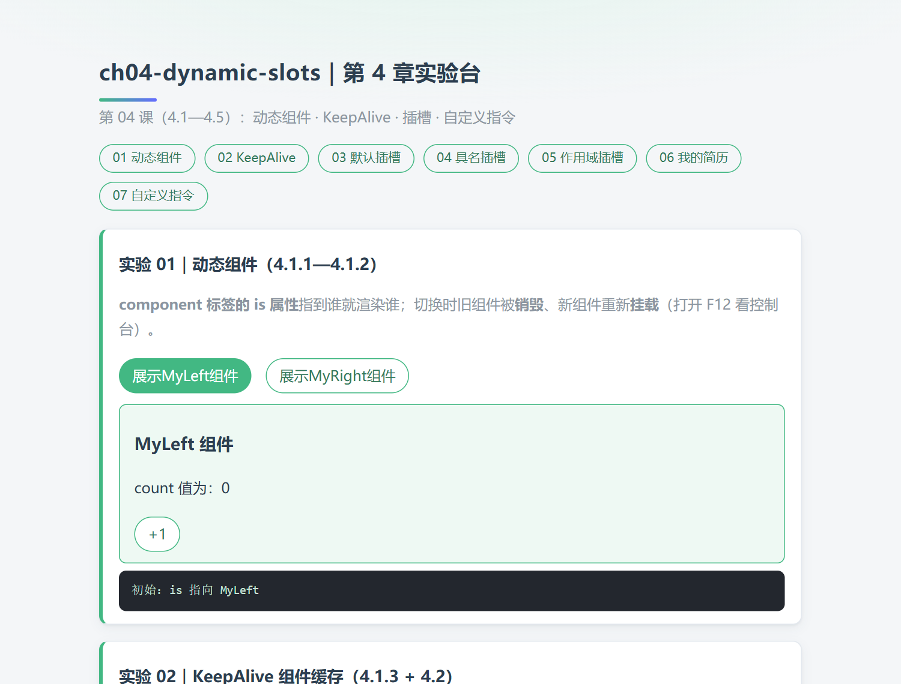
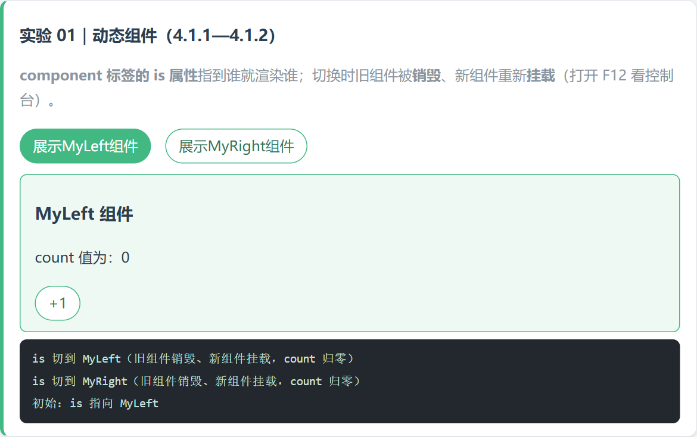
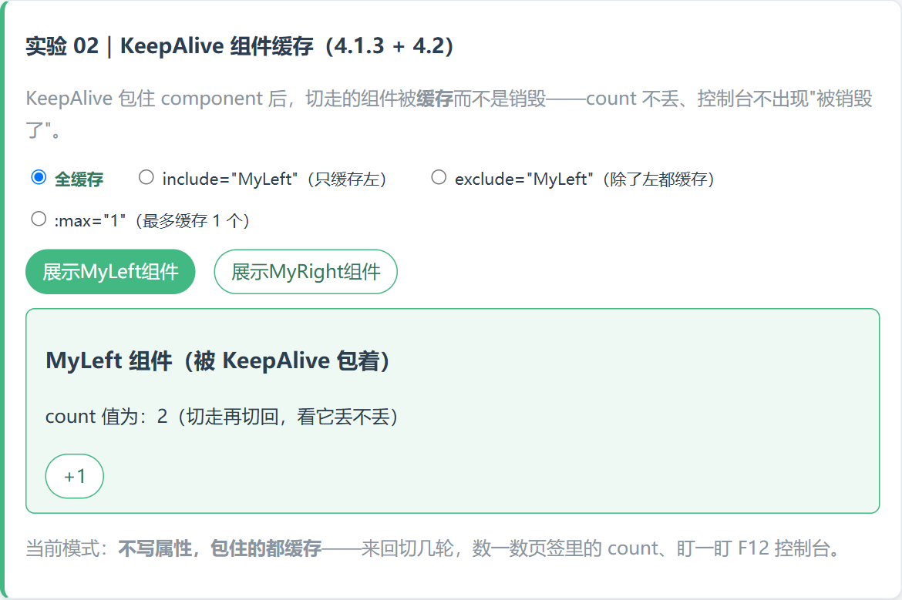
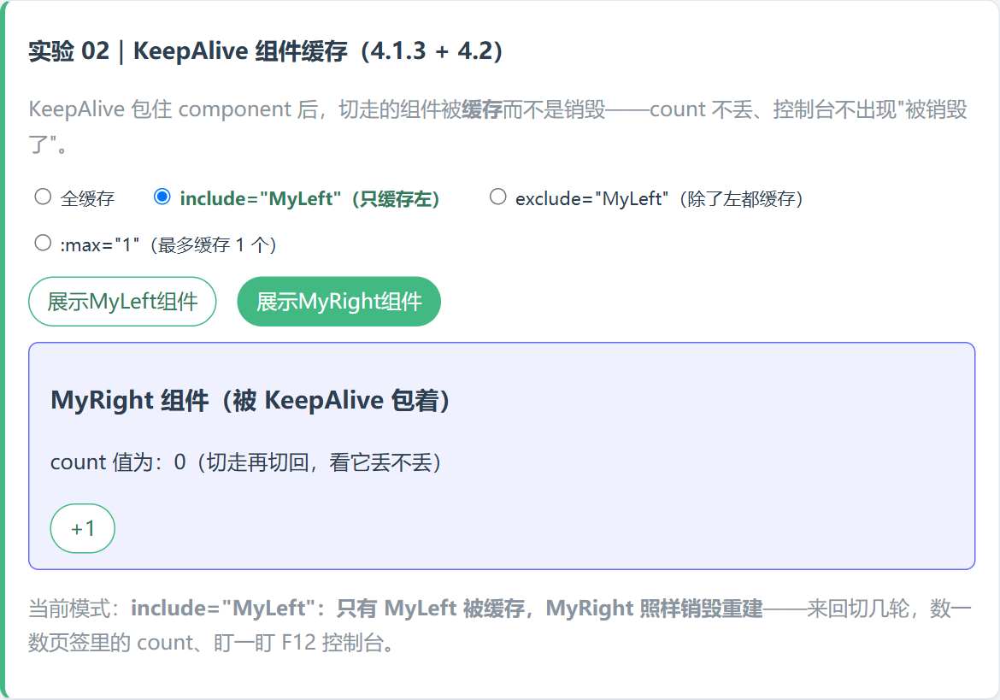
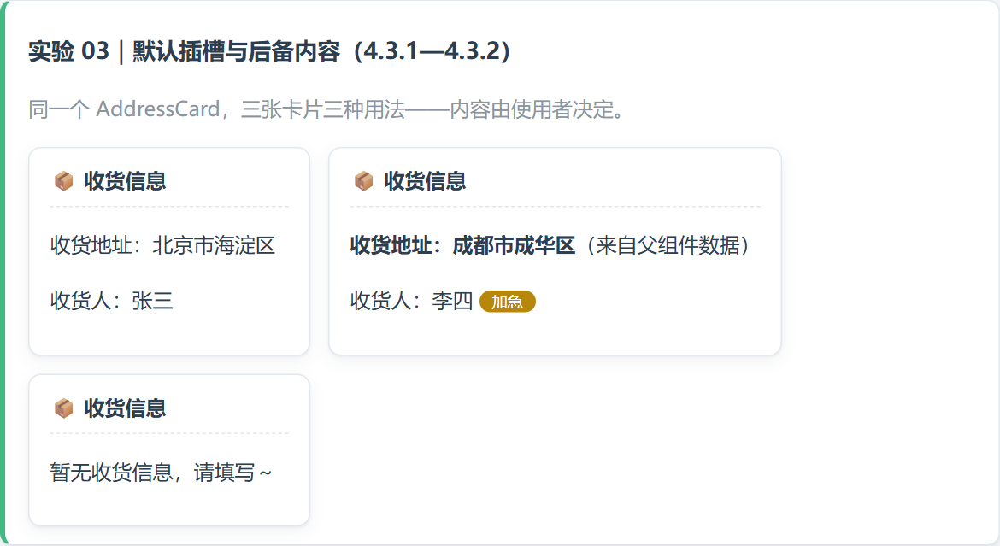
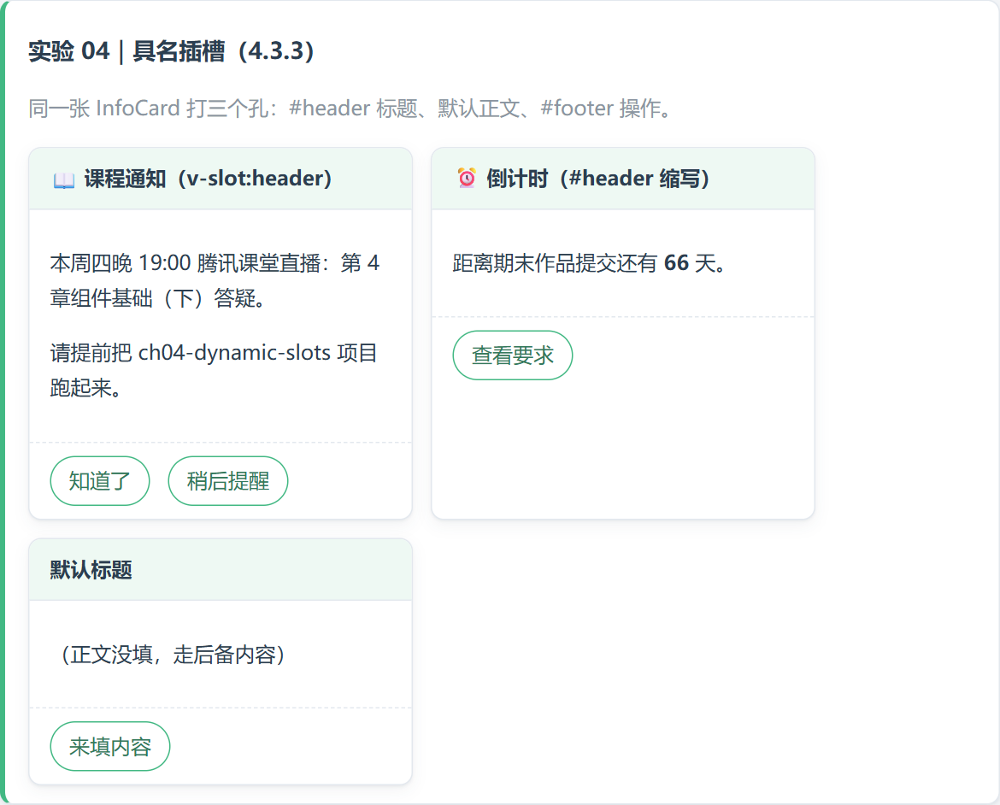
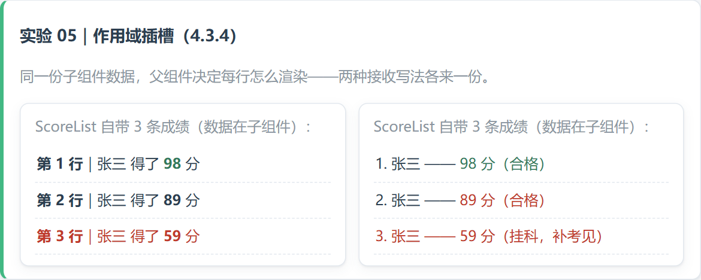
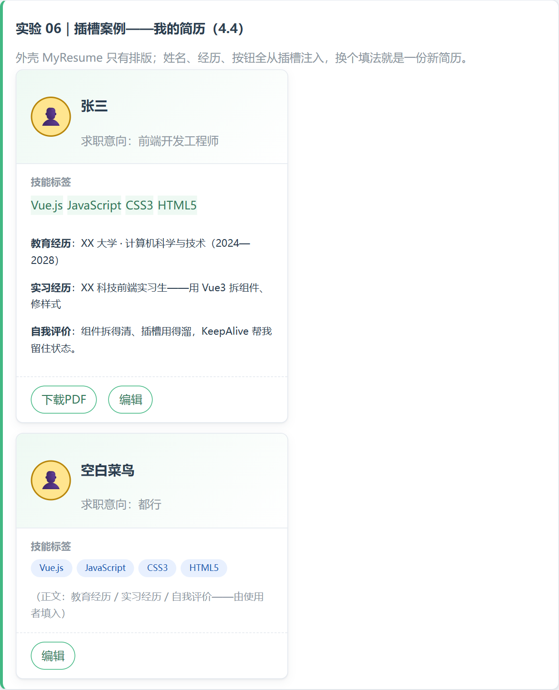
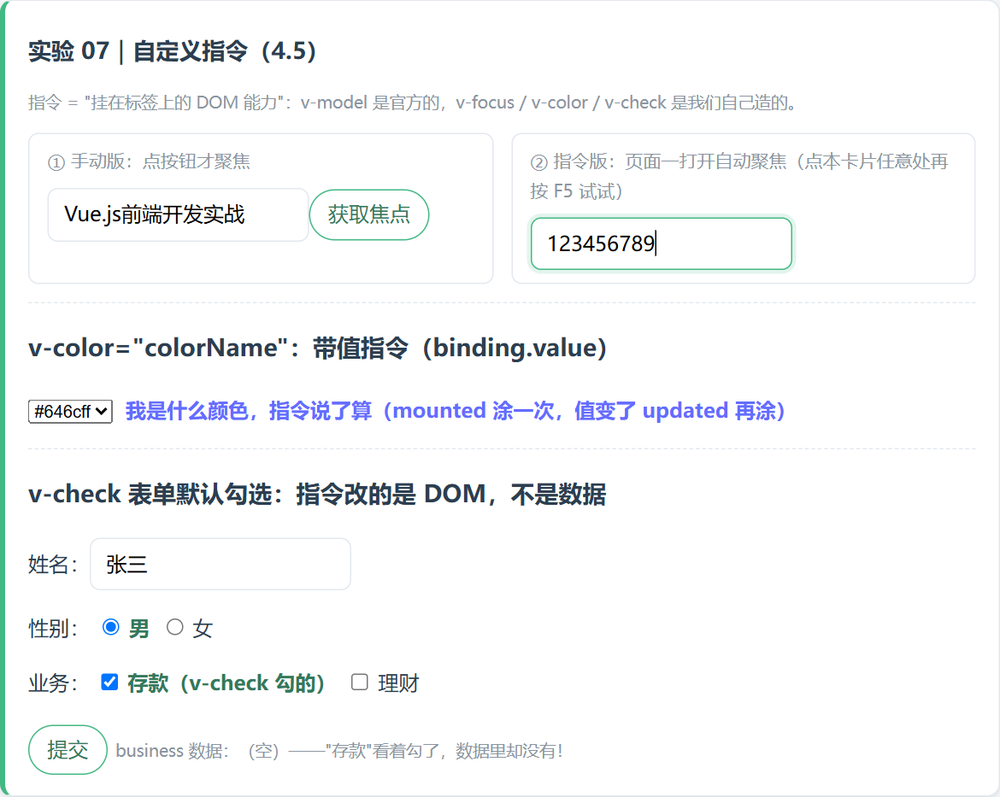

# 第 04 课：动态组件 · KeepAlive · 插槽 · 自定义指令 —— 从"切组件"到"造模板"（4.1—4.5）

| 项目 | 内容 |
|---|---|
| 课程 | WEB 前端框架技术（203051）· 2026—2027 学年第一学期 · 2024 级计算机科学与技术 |
| 本课学时 | **4 学时（180 分钟）**：上半场 90′ + 课间 10′ + 下半场 90′，**以实验任务流为主线**，知识点在做中穿插讲 |
| 教材 | 《Vue.js 前端开发实战（第 2 版）》黑马程序员，人民邮电出版社 · **第 4 章组件基础（下）4.1—4.5（书页 91—115，本次扫描件核实）** |
| 对应教案单元 | 第 17—20 学时（第 4 章动态组件 / KeepAlive / 插槽 / 自定义指令）——按课程节奏随第 4 次课（学时 13—16）推进 |
| 对应实验 | 章节实验 **`ch04-dynamic-slots`**（《[00-项目目录与命名规范](../实验指导/00-项目目录与命名规范.md)》4.1 章节实验代号表）：进章新建一次 + 小实验 01—07 |
| 对应大纲 | 实验项目 7「动态组件 KeepAlive 与插槽」+ 实验项目 8「自定义指令」（历史代号 lab07 / lab08，见《00-规范》4.2） |
| 贯穿项目 | notes-app **本课课堂不动**——综合作业继续在课后长：上次拆好的组件骨架，这次用**插槽**再升级一层（见任务 8 作业表） |
| 前置检查 | ch03-components 提交已推送；**notes-app 组件化综合作业已完成**（NoteHeader / NoteForm / NoteList / NoteItem 四件套能跑） |

> **本课怎么上**：第 3 章学会了"拆组件、传数据"，这一章回答三个新问题——**怎么在一个位置切换组件**（动态组件 + KeepAlive）、**怎么让一个组件千人千面**（插槽三连：默认 / 具名 / 作用域）、**怎么给标签挂自己的超能力**（自定义指令）。组织方式沿用「一章 = 一个大实验」：上半场进章新建 **ch04-dynamic-slots**，连做动态组件、KeepAlive、默认插槽三个小实验；下半场具名插槽、作用域插槽、简历案例、自定义指令四连收尾。三个约定不变：① 选项式主线 + 📖 教材写法对照（**选项式会写、组合式会读**）；② 每任务附 **🐣 初学者卡点表**；③ 命令统一 **CMD**、提交 `ch04-dynamic-slots-学号`、截图 `ch04-序号-说明.png`。
>
> ⏱️ **节奏提示（师生共勉）**：上半场实验 01→02 是同一个故事的两次反转（"切换丢状态"→"KeepAlive 救回来"），做到哪讲到哪、**过而不恋**；下半场四个实验的组件都不大（30—90 行），照着代码敲完就跑，验证动作做一遍即过。

---

## 目录

**上半场（学时 13—14）：第 4 章大实验 ch04-dynamic-slots —— 切组件 · 存状态 · 填内容**

- [任务 0｜开场三步 + 新建 ch04-dynamic-slots + 实验台骨架（10′）](#t40)
- [任务 1｜小实验 01：动态组件——component :is + 销毁重建（4.1.1—4.1.2）（22′）](#t41)
- [任务 2｜小实验 02：KeepAlive 缓存 + 激活失活 + 三个属性（4.1.3 + 4.2）（28′）](#t42)
- [任务 3｜小实验 03：默认插槽 + 后备内容（4.3.1—4.3.2）（20′）](#t43)
- [上半场收尾｜提交 ch04-dynamic-slots（5′）](#t4c)
- 课间 10′

**下半场（学时 15—16）：ch04-dynamic-slots（续）—— 多孔位 · 递数据 · 造指令**

- [任务 4｜小实验 04：具名插槽（4.3.3）（15′）](#t44)
- [任务 5｜小实验 05：作用域插槽 + 解构插槽Prop（4.3.4）（18′）](#t45)
- [任务 6｜小实验 06：插槽案例——我的简历（4.4）（20′）](#t46)
- [任务 7｜小实验 07：自定义指令——v-focus / v-color / v-check（4.5）（25′）](#t47)
- [任务 8｜教材案例与习题映射 + 提交 + 课末收尾（12′）](#t4w)（知识树、术语速查表、知识地图、课堂五问、作业与预告）
- [跟练进度自检清单（可打印）](#t4ck)

**附录**

- [附录 A｜任务流与教案、章节实验、教材的对应关系](#t4a)
- [附录 B｜教材 ↔ 本地实测环境差异对照表](#t4b)
- [附录 C｜参考资料](#t4cc)

> **符号图例**（同第 02、03 课）：✏️ = 增量片段（`＋` 新增行 / `✱` 修改行）｜ 📄 = 对账用完整快照 ｜ 📌 = 对照效果图 ｜ 📖 = 教材写法对照 / 认知卡 ｜ 🐣 = 初学者卡点表 ｜ ✅ = 检查点

---

## 〇、上课前 3 分钟：先对齐"环境事实"

机房环境与上次课一致（实测：Node v22.23.2 / npm 10.9.8 / Vite 8.3.x / Vue 3.5.x / VS Code，镜像源 npmmirror）。本课新增四条预警（均据教材第 4 章扫描件书页 91—115 核实）：

> ⚠️ **四处"教材 ↔ 课程"口径预警**：
> 1. **教材示例项目是 `D:\vue\chapter04`、示例放 `src\components\06\` 子目录、每节改 main.js 换组件演示**——课程固定走章节实验口径：`labs\ch04-dynamic-slots\` 一次建好，小实验放 `src\experiments\NN-节短名\`，实验台 App.vue 一次挂全，不再来回改 main.js；
> 2. **教材 4.1—4.2 的示例组件是 `<script setup>` 组合式**（`shallowRef` + `showComponent`、`onActivated()` / `onDeactivated()` 函数）——课程主线是选项式：`data` 里 `shallowRef`、`activated()` / `deactivated()` 选项，每处配 📖 对照；
> 3. **KeepAlive 是 Vue 内置组件**：模板里直接写 `<KeepAlive>`（或 `<keep-alive>`）即可，**不需要 import、不需要注册**——第一次见"不用注册就能用的组件"，先说破免得学生到处找 import；
> 4. **本章小节编号以扫描教材为准**：4.1 动态组件（4.1.1 定义 / 4.1.2 切换 / 4.1.3 KeepAlive 缓存）→ 4.2 KeepAlive 进阶（4.2.1 缓存生命周期 / 4.2.2 常用属性）→ 4.3 插槽（4.3.1 默认 / 4.3.2 后备 / 4.3.3 具名 / 4.3.4 作用域）→ 4.4 简历案例 → 4.5 自定义指令 → 4.6 小结。出版社配套 PPT 的编号是另一套（其 4.2 插槽 / 4.3 指令 / 4.4 静态资源 / 4.5 商品管理案例），其中"引用静态资源、商品管理案例"两块**不在本次教材扫描件内、本课不讲**（差异全表见附录 B）。

### 本章地图：一章 = 一个大实验（第 4 章的划分）

沿用第 03 课起的组织方式：**每教学章一个完整实验项目**（进章第一次课 `npm create vite` 建一次，之后章内不再新建）；**章内按教材小节划分小实验**——每个小实验一个目录、一到几个组件、自成一体；实验台 `App.vue` 锚点菜单串成一页。

| | 完整实验项目（`labs\` 下，新建一次） | 章内小实验（`src\experiments\NN-节短名\`） | 课内时机 | 提交 / 截图代号 |
|---|---|---|---|---|
| 第 4 章（4.1—4.5） | `ch04-dynamic-slots` | 01-dynamic · 02-keepalive · 03-slot-basic · 04-named-slot · 05-scoped-slot · 06-resume · 07-directive | 上半场 01—03，下半场 04—07 | `ch04-dynamic-slots` |

目录树速览：

```
labs\ch04-dynamic-slots\
├── src\
│   ├── App.vue                 ← 实验台：锚点菜单 + 挂载各小实验
│   ├── style.css               ← 课程设计令牌（从 ch03/ch02 复制）
│   └── experiments\
│       ├── 01-dynamic\         ← 4.1.1—4.1.2 动态组件
│       ├── 02-keepalive\       ← 4.1.3 + 4.2 KeepAlive 与缓存生命周期
│       ├── 03-slot-basic\      ← 4.3.1—4.3.2 默认插槽 + 后备内容
│       ├── 04-named-slot\      ← 4.3.3 具名插槽
│       ├── 05-scoped-slot\     ← 4.3.4 作用域插槽
│       ├── 06-resume\          ← 4.4 案例：我的简历
│       └── 07-directive\       ← 4.5 自定义指令
└── package.json
```

---

## 一、本节课流程总览（4 学时 · 以实验任务为主线）

### 上半场（学时 13—14，90′）：ch04-dynamic-slots —— 切组件 · 存状态 · 填内容

| # | 实验任务（主线） | 穿插知识点 | 时间 | 小实验目录 |
|---|---|---|---|---|
| 0 | 开场三步 + 新建 ch04-dynamic-slots + 实验台骨架 | 进章建项目 · 设计令牌复用 | 10′ | 项目骨架 |
| 1 | 动态组件：component :is + 切换即销毁重建 | **4.1.1—4.1.2** | 22′ | 01-dynamic |
| 2 | KeepAlive：缓存不销毁 + 激活失活 + include/exclude/max | **4.1.3 + 4.2.1—4.2.2** | 28′ | 02-keepalive |
| 3 | 默认插槽 + 后备（兜底）内容 | **4.3.1—4.3.2** | 20′ | 03-slot-basic |
| 4 | 提交 ch04-dynamic-slots（上半场版） | Git 节奏 | 5′ | —— |

**课间 10′**（dev 服务器不关；离开座位请锁屏 `Win + L`）

### 下半场（学时 15—16，90′）：ch04-dynamic-slots（续）—— 多孔位 · 递数据 · 造指令

| # | 实验任务（主线） | 穿插知识点 | 时间 | 小实验目录 |
|---|---|---|---|---|
| 5 | 具名插槽：一组件多孔位 + # 缩写 | **4.3.3** | 15′ | 04-named-slot |
| 6 | 作用域插槽：数据在子、渲染权在父 | **4.3.4** | 18′ | 05-scoped-slot |
| 7 | 插槽案例：我的简历（综合运用） | **4.4** | 20′ | 06-resume |
| 8 | 自定义指令：v-focus / v-color / v-check | **4.5.1—4.5.3** | 25′ | 07-directive |
| 9 | 教材习题映射 + 提交 + 课末收尾 | **4.6** | 12′ | —— |

（教师参考：本课全部代码已实测跑通，完整可运行版存于 [web-framework-2024xxxx/ch04-dynamic-slots](../web-framework-2024xxxx/ch04-dynamic-slots/)，18 项自动断言全部通过（销毁重建 / 缓存保留 / include 生效 / 指令钩子 / 数据绑定边界）；真实截图存于 [第04课效果图](./第04课效果图/)：ch04-01—ch04-09 共 9 张。）

---

# 上半场（学时 13—14）：第 4 章大实验 ch04-dynamic-slots

<a id="t40"></a>

## 任务 0｜开场三步 + 新建 ch04-dynamic-slots + 实验台骨架（10 分钟）

### 【讲】进第 4 章：会拆组件之后，学"切换、缓存、定制"

第 3 章我们把 notes-app 拆成了一堆小组件——那是"静态地摆"。真实页面里组件是**动的**：后台管理的左边菜单点一下、右边内容区整个换一张脸，这是**动态组件**；切走再切回来，填了一半的表单不能清空，这是 **KeepAlive 缓存**；同一个卡片组件，商品页装商品、评论页装评论，这是**插槽**；最后再给自己造一个 `v-focus` 这样的"官方指令同款"，这是**自定义指令**。四件事都在一个新章节实验项目里做完。

### 【做】第 1 步：开场三步 + 进章建项目

```bat
rem ① 回课程仓库 → ② 拉取远程 → ③ 进 labs 建第 4 章完整实验项目
cd /d D:\web-framework-2024xxxx
git pull
cd labs
npm create vite@latest ch04-dynamic-slots
rem 交互选择与第 01 课相同：Framework → Vue ｜ Variant → JavaScript
cd ch04-dynamic-slots
npm install
```

### 【做】第 2 步：清脚手架 + 复用设计令牌

```bat
rem 仍在 labs\ch04-dynamic-slots 目录下
del src\components\HelloWorld.vue
copy /y ..\ch03-components\src\style.css src\style.css
```

`style.css` 还是那一套**设计令牌**（`--primary` / `--card` / `--radius`…），从上周的 ch03 直接复制——整门课一套视觉。

### 【做】第 3 步：实验台 App.vue（七连实验的挂载板）

**📄 `src/App.vue`｜整体替换脚手架欢迎页（完整）：**

```vue
<template>
  <div id="app">
    <h1>ch04-dynamic-slots｜第 4 章实验台</h1>
    <p class="muted">第 04 课（4.1—4.5）：动态组件 · KeepAlive · 插槽 · 自定义指令</p>

    <nav class="lab-nav">
      <a href="#exp-01">01 动态组件</a>
      <a href="#exp-02">02 KeepAlive</a>
      <a href="#exp-03">03 默认插槽</a>
      <a href="#exp-04">04 具名插槽</a>
      <a href="#exp-05">05 作用域插槽</a>
      <a href="#exp-06">06 我的简历</a>
      <a href="#exp-07">07 自定义指令</a>
    </nav>

    <!-- 一个小实验一个 section：id 与菜单锚点对应，先占位、逐实验填充 -->
    <section id="exp-01"><p class="muted">（任务 1 完成后挂载 DynamicLab）</p></section>
    <section id="exp-02"><p class="muted">（任务 2 完成后挂载 KeepAliveLab）</p></section>
    <section id="exp-03"><p class="muted">（任务 3 完成后挂载 SlotBasicLab）</p></section>
    <section id="exp-04"><p class="muted">（任务 4 完成后挂载 NamedSlotLab）</p></section>
    <section id="exp-05"><p class="muted">（任务 5 完成后挂载 ScopedSlotLab）</p></section>
    <section id="exp-06"><p class="muted">（任务 6 完成后挂载 ResumeLab）</p></section>
    <section id="exp-07"><p class="muted">（任务 7 完成后挂载 DirectiveLab）</p></section>
  </div>
</template>

<script>
export default {
  name: 'App'
}
</script>

<style scoped>
.lab-nav {
  display: flex;
  flex-wrap: wrap;
  gap: 10px;
  margin: 12px 0 20px;
}

.lab-nav a {
  color: var(--primary-dark);
  text-decoration: none;
  border: 1px solid var(--primary);
  border-radius: 999px;
  padding: 3px 14px;
  font-size: 14px;
}

.lab-nav a:hover {
  background: var(--primary-bg);
}

section {
  margin: 18px 0;
}

.muted {
  color: var(--muted);
  margin-top: 0;
}
</style>
```

```bat
rem 第 4 步：启动（本上半场都在这个目录里干）
npm run dev
```

📌 先看一眼终态长什么样（上半场终点——前三个实验挂上、实验 01 的 MyLeft 页签在台上）：



✅ **检查点 0**：实验台出页面；顶部菜单七个锚点能跳（七个区块暂时是占位文字）；`localhost:5173` 正常。

---

<a id="t41"></a>

## 任务 1｜小实验 01：动态组件——component :is + 销毁重建（4.1.1—4.1.2）（22 分钟）

### 【讲】知识点 1：动态组件是什么（4.1.1）

**一句话定义**：动态组件 = **用一个 `<component>` 标签当"占位符"，`:is` 指到哪个组件就渲染哪个组件**。
**类比**：一台电视机一个屏幕（`<component>`），`:is` 是遥控器选台——屏幕不换，节目随台换。
**语法**（教材 91 页）：

```html
<component :is="要渲染的组件"></component>
```

> ❓ **课堂设问**：两个按钮切换两个组件，`v-if` / `v-else` 也能做，为什么还要动态组件？（页签一多 `v-if` 连环写十层；`<component>` 一个坑位全搞定——后台管理"一个内容区 + N 个菜单"就是它的主场。）

### 【做】第 1 步：两个页签子组件

```bat
mkdir src\experiments\01-dynamic
```

**✏️ `src/experiments/01-dynamic/MyLeft.vue`｜新建文件（完整）：**

```vue
<!-- ============================================================
  MyLeft.vue —— 实验 01 子组件：左页签（4.1.2）
  目录：experiments/01-dynamic/
  要点：带一个 count，配合父组件观察"切换 = 销毁重建"
============================================================ -->
<template>
  <div class="tab-card left">
    <h3>MyLeft 组件</h3>
    <p>count 值为：{{ count }}</p>
    <button @click="count++">+1</button>
  </div>
</template>

<script>
export default {
  name: 'MyLeft',
  data() {
    return { count: 0 }
  },
  mounted() {
    console.log('MyLeft组件挂载完了')
  },
  unmounted() {
    console.log('MyLeft组件被销毁了')
  }
}
</script>

<style scoped>
.tab-card {
  border: 1.5px solid var(--primary);
  border-radius: 8px;
  padding: 10px 16px;
  margin-top: 10px;
  background: var(--primary-bg);
}

.tab-card.left {
  border-color: var(--primary);
}
</style>
```

**✏️ `src/experiments/01-dynamic/MyRight.vue`｜新建文件（完整）：**

```vue
<!-- ============================================================
  MyRight.vue —— 实验 01 子组件：右页签（4.1.2）
  目录：experiments/01-dynamic/
  要点：与 MyLeft 同构，只换文案与配色
============================================================ -->
<template>
  <div class="tab-card right">
    <h3>MyRight 组件</h3>
    <p>component 标签 is 属性绑定的组件换了，页面跟着换。</p>
    <p>count 值为：{{ count }}</p>
    <button @click="count++">+1</button>
  </div>
</template>

<script>
export default {
  name: 'MyRight',
  data() {
    return { count: 0 }
  },
  mounted() {
    console.log('MyRight组件挂载完了')
  },
  unmounted() {
    console.log('MyRight组件被销毁了')
  }
}
</script>

<style scoped>
.tab-card {
  border: 1.5px solid var(--accent);
  border-radius: 8px;
  padding: 10px 16px;
  margin-top: 10px;
  background: #f0f1ff;
}

.tab-card.right {
  border-color: var(--accent);
}
</style>
```

两个子组件各带一个 `count`、各在挂载/销毁时 `console.log`——**现象全靠它们做证词**。

### 【讲】知识点 2：shallowRef——为什么要"包一层"

`:is` 绑的是**组件对象本身**（不是字符串）。组件对象一旦进了 `data`，Vue 会把它深度代理成响应式对象——组件定义八竿子打不着的数据变化，纯属浪费。**`shallowRef` = 浅层响应式**：只追踪"换了哪个组件"，不深入组件内部瞎代理。教材 91—93 页全程用它，我们照做。

📖 **教材写法对照①（4.1.1，书页 92—93）**——同一效果两种口味：

```html
<!-- 教材【组合式】<script setup>：import 的东西模板直接可用 -->
<script setup>
import { shallowRef } from 'vue'
import MyLeft from './MyLeftComponent.vue'
import MyRight from './MyRightComponent.vue'

const showComponent = shallowRef(MyLeft)   // 换台：showComponent.value = MyRight
</script>

<template>
  <button @click="showComponent = MyLeft">展示MyLeft组件</button>
  <button @click="showComponent = MyRight">展示MyRight组件</button>
  <component :is="showComponent"></component>
</template>
```

```html
<!-- 【课程选项式】：组件对象走 data 里的 shallowRef；
     模板要用 MyLeft / MyRight 这两个名字，得靠 computed 暴露（见下） -->
```

> 📖 **两个口径差**（选项式转组合式最常踩）：
> ① `<script setup>` 里 import 的组件**模板直接可用**；选项式模板只认实例上的东西，所以要加两个 computed 把 `MyLeft` / `MyRight` 递出去；
> ② 选项式 `data` 里的 ref 会被**自动解包**：模板和 `watch` 都直接写 `cur`（拿到组件对象），**不能写 `cur.value`**——`.value` 是组合式的口径（本次实测：watch 写 `'cur.value'` 静默失效，写成 `'cur'` 才触发）。

### 【做】第 2 步：DynamicLab 主组件 + 挂载

**✏️ `src/experiments/01-dynamic/DynamicLab.vue`｜新建文件（完整）：**

```vue
<!-- ============================================================
  DynamicLab.vue —— 小实验 01：动态组件（4.1.1—4.1.2）
  目录：experiments/01-dynamic/
  要点：<component :is> 占位渲染 ｜ shallowRef 浅层包装 ｜ 切换 = 销毁重建
  自足说明：本实验自带 MyLeft / MyRight 两个子组件，不依赖外部
============================================================ -->
<template>
  <div class="lab">
    <h2>实验 01｜动态组件（4.1.1—4.1.2）</h2>
    <p class="muted">
      <b>component 标签的 is 属性</b>指到谁就渲染谁；切换时旧组件被<b>销毁</b>、新组件重新<b>挂载</b>（打开 F12 看控制台）。
    </p>

    <div class="tabs">
      <button :class="{ on: cur === MyLeft }" @click="cur = MyLeft">展示MyLeft组件</button>
      <button :class="{ on: cur === MyRight }" @click="cur = MyRight">展示MyRight组件</button>
    </div>

    <component :is="cur"></component>

    <ol class="logs">
      <li v-for="(item, index) in logs" :key="index">{{ item }}</li>
    </ol>
  </div>
</template>

<script>
import { shallowRef } from 'vue'
import MyLeft from './MyLeft.vue'
import MyRight from './MyRight.vue'

export default {
  name: 'DynamicLab',
  components: { MyLeft, MyRight },
  data() {
    return {
      cur: shallowRef(MyLeft),
      logs: ['初始：is 指向 MyLeft']
    }
  },
  computed: {
    // 模板里要写 cur = MyLeft，得把两个组件对象暴露给模板（computed 不加 this 前缀直接引用 import）
    MyLeft() {
      return MyLeft
    },
    MyRight() {
      return MyRight
    }
  },
  watch: {
    // data 里的 shallowRef 会被自动解包：模板和 watch 都直接用 cur，
    // 拿到的已经是组件对象本身（不能写 'cur.value'——那是组合式的 .value 口径）
    cur(comp) {
      const name = comp === MyLeft ? 'MyLeft' : 'MyRight'
      this.logs.unshift(`is 切到 ${name}（旧组件销毁、新组件挂载，count 归零）`)
    }
  }
}
</script>

<style scoped>
.lab {
  background: var(--card, #fff);
  border: 1px solid var(--border);
  border-left: 4px solid var(--primary);
  border-radius: var(--radius);
  box-shadow: var(--shadow);
  padding: 14px 18px;
}

.tabs {
  display: flex;
  gap: 10px;
}

.tabs button.on {
  background: var(--primary);
  border-color: var(--primary);
  color: #fff;
}

.logs {
  list-style: none;
  background: #23272e;
  color: #c9e3d6;
  font-family: Consolas, Monaco, monospace;
  font-size: 13px;
  border-radius: 8px;
  margin: 8px 0 0;
  padding: 10px 14px;
  min-height: 2em;
}

.logs li {
  line-height: 1.9;
}

.muted {
  color: var(--muted);
}
</style>
```

**✏️ `src/App.vue`｜两处增量挂载（＋ 为新增）：**

改动①：`<script>` 里 import 与 components——修改前：

```js
<script>
export default {
  name: 'App'
}
</script>
```

修改后：

```js
<script>
import DynamicLab from './experiments/01-dynamic/DynamicLab.vue'
＋
 export default {
   name: 'App',
＋  components: { DynamicLab }
 }
</script>
```

改动②：`exp-01` 区块换真身——修改前：

```html
    <section id="exp-01"><p class="muted">（任务 1 完成后挂载 DynamicLab）</p></section>
```

修改后：

```html
    <section id="exp-01"><DynamicLab /></section>
```

（后面任务 2—7 的挂载都是这两处套路：**import + components 加一名、对应 section 换组件**，不再重复解释。）

### 【实验】"切换 = 销毁重建"三连证

1. 点两次 `+1` → count 变 2；
2. 点"展示MyRight组件" → 左卡片整个消失、右卡片出现，count 从 0 开始；
3. 再点"展示MyLeft组件" → **count 回到 0**（不是 2！）。

**实测控制台输出**（F12 → Console，本机跑出来的原文）：

```
MyLeft组件挂载完了        ← 页面打开（初始挂载）
MyLeft组件被销毁了        ← 切到 MyRight：旧组件销毁
MyRight组件挂载完了       ← 新组件挂载
MyRight组件被销毁了       ← 切回 MyLeft：右组件销毁
MyLeft组件挂载完了        ← 左组件重新挂载（count 归零）
```

### 【讲】知识点 3：销毁重建意味着什么（4.1.2 的现象总结）

切换动态组件 = **旧的卸载、新的从零挂载**：`data` 全清零、`unmounted` 触发、DOM 重建。表单填一半切个页签全没——这不是 bug，是默认行为；要"切走保留"，正是下一个实验 KeepAlive 的戏。

📌 对照图 01（切回 MyLeft：count 归零、日志记录了两次切换）：



✅ **检查点 1**：切回 MyLeft 后 count 是 0；控制台能看到"销毁了/挂载完了"成对出现；页内黑色日志区记着两条切换记录。

### 🐣 初学者卡点 1（动态组件）

| 现象 | 原因 | 解决 |
|---|---|---|
| 控制台报警告，页面空白 | `:is` 绑了字符串 `'MyLeft'`，但当前写法没注册该名字的组件 | 按 `:is="cur"` 绑**组件对象**（本课口径）；绑字符串需先注册组件名 |
| 保存后整页卡死/奇慢 | `data` 里直接放组件对象没包 `shallowRef`，组件定义被深度代理 | `cur: shallowRef(MyLeft)`——组件对象一律浅层包 |
| 按钮点了没反应，也没报错 | 选项式模板里写 `@click="cur = MyLeft"`，但 `MyLeft` 没暴露给模板 | 加两个 computed（`MyLeft()` / `MyRight()`）返回 import 的组件 |
| watch 死活不触发 | 写成 `watch: { 'cur.value'(…) }`——选项式 data 的 ref 自动解包，`cur.value` 恒为 undefined | 写 `watch: { cur(comp) { … } }`，拿到的就是组件对象 |
| 切换正常但"高亮按钮"不跟着亮 | `:class="{ on: cur === MyLeft }` 里比较的是解包后的组件对象，与 computed 返回的**同一个**引用才相等 | 别在别处再 new / 再 import 一份组件比较，统一用 computed 暴露的那个 |

---

<a id="t42"></a>

## 任务 2｜小实验 02：KeepAlive 缓存 + 激活失活 + 三个属性（4.1.3 + 4.2）（28 分钟）

### 【讲】知识点 1：KeepAlive——把"扔掉"变"收起来"（4.1.3）

**一句话定义**：KeepAlive 是 Vue **内置组件**，用 `<KeepAlive>` 把动态组件包住后，切走的组件**不销毁、只缓存**——再切回来时状态还在。
**类比**：默认切换像**把文件扔进碎纸机**（回来重写）；KeepAlive 像**把文件收进抽屉**（回来接着用）。
**语法**（教材 93—94 页）：

```html
<KeepAlive>
  <component :is="cur"></component>
</KeepAlive>
```

三个提醒：① KeepAlive **不用 import、不用注册**，模板里直接写（内置组件）；② 标签写 `<KeepAlive>` 或 `<keep-alive>` 都行，课程统一大驼峰；③ 它**只认包在里面的动态组件**这一用法（本课口径）。

### 【做】第 1 步：升级版页签（带缓存专属生命周期）

```bat
mkdir src\experiments\02-keepalive
```

**✏️ `src/experiments/02-keepalive/MyLeft.vue`｜新建文件（完整）：**

```vue
<!-- ============================================================
  MyLeft.vue —— 实验 02 子组件：带缓存生命周期的左页签（4.2.1）
  目录：experiments/02-keepalive/
  要点：mounted/unmounted 只在"真挂载/真销毁"时触发；
        activated/deactivated 在"被激活/被缓存（失活）"时触发
============================================================ -->
<template>
  <div class="tab-card left">
    <h3>MyLeft 组件（被 KeepAlive 包着）</h3>
    <p>count 值为：{{ count }}（切走再切回，看它丢不丢）</p>
    <button @click="count++">+1</button>
  </div>
</template>

<script>
export default {
  name: 'MyLeft',
  data() {
    return { count: 0 }
  },
  mounted() {
    console.log('MyLeft组件挂载完了')
  },
  unmounted() {
    console.log('MyLeft组件被销毁了')
  },
  activated() {
    console.log('MyLeft组件被激活了')
  },
  deactivated() {
    console.log('MyLeft组件被缓存了')
  }
}
</script>

<style scoped>
.tab-card {
  border: 1.5px solid var(--primary);
  border-radius: 8px;
  padding: 10px 16px;
  margin-top: 10px;
  background: var(--primary-bg);
}
</style>
```

**✏️ `src/experiments/02-keepalive/MyRight.vue`｜新建文件（完整）：**

```vue
<!-- ============================================================
  MyRight.vue —— 实验 02 子组件：带缓存生命周期的右页签（4.2.1）
  目录：experiments/02-keepalive/
  要点：与 MyLeft 同构；exclude / include 模式下观察它的差别
============================================================ -->
<template>
  <div class="tab-card right">
    <h3>MyRight 组件（被 KeepAlive 包着）</h3>
    <p>count 值为：{{ count }}（切走再切回，看它丢不丢）</p>
    <button @click="count++">+1</button>
  </div>
</template>

<script>
export default {
  name: 'MyRight',
  data() {
    return { count: 0 }
  },
  mounted() {
    console.log('MyRight组件挂载完了')
  },
  unmounted() {
    console.log('MyRight组件被销毁了')
  },
  activated() {
    console.log('MyRight组件被激活了')
  },
  deactivated() {
    console.log('MyRight组件被缓存了')
  }
}
</script>

<style scoped>
.tab-card {
  border: 1.5px solid var(--accent);
  border-radius: 8px;
  padding: 10px 16px;
  margin-top: 10px;
  background: #f0f1ff;
}
</style>
```

### 【讲】知识点 2：缓存专属生命周期（4.2.1，教材 94—96 页）

被 KeepAlive 包住的组件，多出两个"缓存世界"的钩子：

| 钩子 | 触发时机 | 教材日志文案 |
|---|---|---|
| `activated` | 组件被**激活**（切回来上台时） | MyLeft组件被激活了 |
| `deactivated` | 组件被**缓存**（切下台失活时） | MyLeft组件被缓存了 |

两条规律（本机实测）：**首次挂载时 `mounted` 和 `activated` 都触发**（上台即激活）；被缓存期间来回切，**只有 activated / deactivated 反复触发**，不再重新挂载。没有被 KeepAlive 包的普通组件，这俩钩子**永远不会触发**。

📖 **教材写法对照②（4.2.1，书页 95）**——教材用组合式函数，课程用选项式钩子：

```html
<!-- 教材【组合式】（MyLeft.vue 的 <script setup> 里） -->
<script setup>
import { onActivated, onDeactivated } from 'vue'

onActivated(() => {
  console.log('MyLeft组件被激活了')
})
onDeactivated(() => {
  console.log('MyLeft组件被缓存了')
})
</script>
```

```js
// 【课程选项式】：同一对钩子写成选项，名字去掉 on 前缀、首字母小写
export default {
  activated() {
    console.log('MyLeft组件被激活了')
  },
  deactivated() {
    console.log('MyLeft组件被缓存了')
  }
}
```

### 【做】第 2 步：KeepAliveLab 主组件（四个缓存模式同台）+ 挂载

**✏️ `src/experiments/02-keepalive/KeepAliveLab.vue`｜新建文件（完整）：**

```vue
<!-- ============================================================
  KeepAliveLab.vue —— 小实验 02：KeepAlive 组件缓存（4.1.3 + 4.2）
  目录：experiments/02-keepalive/
  要点：<KeepAlive> 包裹后组件切走不销毁、count 保留 ｜
        activated / deactivated 缓存专属生命周期 ｜
        include / exclude / max 三个常用属性（4.2.2）
  自足说明：本实验自带 MyLeft / MyRight 两个子组件，不依赖外部
============================================================ -->
<template>
  <div class="lab">
    <h2>实验 02｜KeepAlive 组件缓存（4.1.3 + 4.2）</h2>
    <p class="muted">
      KeepAlive 包住 component 后，切走的组件被<b>缓存</b>而不是销毁——count 不丢、控制台不出现"被销毁了"。
    </p>

    <div class="mode-row">
      <label><input type="radio" value="all" v-model="mode" /> 全缓存</label>
      <label><input type="radio" value="include" v-model="mode" /> include="MyLeft"（只缓存左）</label>
      <label><input type="radio" value="exclude" v-model="mode" /> exclude="MyLeft"（除了左都缓存）</label>
      <label><input type="radio" value="max" v-model="mode" /> :max="1"（最多缓存 1 个）</label>
    </div>

    <div class="tabs">
      <button :class="{ on: cur === MyLeft }" @click="cur = MyLeft">展示MyLeft组件</button>
      <button :class="{ on: cur === MyRight }" @click="cur = MyRight">展示MyRight组件</button>
    </div>

    <!-- 同一个 KeepAlive，四个属性随单选切换：undefined 表示"不启用该属性" -->
    <KeepAlive
      :include="mode === 'include' ? 'MyLeft' : undefined"
      :exclude="mode === 'exclude' ? 'MyLeft' : undefined"
      :max="mode === 'max' ? 1 : undefined"
    >
      <component :is="cur"></component>
    </KeepAlive>

    <p class="muted">
      当前模式：<b>{{ modeLabel }}</b>——来回切几轮，数一数页签里的 count、盯一盯 F12 控制台。
    </p>
  </div>
</template>

<script>
import { shallowRef } from 'vue'
import MyLeft from './MyLeft.vue'
import MyRight from './MyRight.vue'

export default {
  name: 'KeepAliveLab',
  components: { MyLeft, MyRight },
  data() {
    return {
      cur: shallowRef(MyLeft),
      mode: 'all'
    }
  },
  computed: {
    MyLeft() {
      return MyLeft
    },
    MyRight() {
      return MyRight
    },
    modeLabel() {
      return {
        all: '不写属性，包住的都缓存',
        include: 'include="MyLeft"：只有 MyLeft 被缓存，MyRight 照样销毁重建',
        exclude: 'exclude="MyLeft"：MyLeft 不缓存，MyRight 被缓存',
        max: ':max="1"：最多缓存 1 个，挤掉最久没用的那个'
      }[this.mode]
    }
  }
}
</script>

<style scoped>
.lab {
  background: var(--card, #fff);
  border: 1px solid var(--border);
  border-left: 4px solid var(--primary);
  border-radius: var(--radius);
  box-shadow: var(--shadow);
  padding: 14px 18px;
}

.mode-row {
  display: flex;
  flex-wrap: wrap;
  gap: 8px 18px;
  margin: 8px 0;
}

.mode-row label {
  font-size: 14px;
}

.tabs {
  display: flex;
  gap: 10px;
  margin-top: 6px;
}

.tabs button.on {
  background: var(--primary);
  border-color: var(--primary);
  color: #fff;
}

.muted {
  color: var(--muted);
}
</style>
```

**✏️ `src/App.vue`｜两处增量挂载**：import 区加 `import KeepAliveLab from './experiments/02-keepalive/KeepAliveLab.vue'`，`components` 加 `KeepAliveLab`；`exp-02` 区块改为 `<KeepAliveLab />`（修改前后对照同任务 1 套路）。

### 【实验】四个模式各来一轮

1. **全缓存**：左页签 +1 两次 → 切右 → 切回：**count 还是 2**；控制台全程没有"被销毁了"。
2. **include="MyLeft"**：切右 +1 → 切回左（左的 count 保留）→ 再切右：**右的 count 归零**（它不在缓存名单里）。
3. **exclude="MyLeft"**：与 include 正相反——左销毁重建、右被缓存。
4. **:max="1"**：两个都"允许缓存"，但抽屉只有一格，装新就得扔最久没用的（LRU）。

**实测控制台输出**（全缓存一轮 / include 一轮，本机原文）：

```
===== 全缓存：来回切一轮 =====
MyLeft组件挂载完了        ← 第一次：真挂载
MyLeft组件被激活了        ← 首次挂载后 activated 也会触发
MyLeft组件被缓存了        ← 切到 MyRight：失活（deactivated），不是销毁
MyRight组件挂载完了
MyRight组件被激活了
MyRight组件被缓存了       ← 切回 MyLeft：右组件失活
MyLeft组件被激活了        ← 切回：只激活、不重新挂载（count 保留）

===== include="MyLeft"：右页签来回一轮 =====
MyLeft组件被缓存了        ← 切到 MyRight
MyRight组件挂载完了       ← MyRight 不在 include 里：正常挂载
MyRight组件被销毁了       ← 切回 MyLeft：不被缓存，销毁
MyLeft组件被激活了        ← MyLeft 被缓存：激活即回
```

### 【讲】知识点 3：KeepAlive 的三个常用属性（4.2.2，教材 96—98 页）

| 属性 | 值类型 | 作用 | 记法 |
|---|---|---|---|
| `include` | 字符串/数组/正则 | **只有**名单内的组件被缓存 | 白名单 |
| `exclude` | 同上 | 名单内的**不**缓存 | 黑名单 |
| `max` | 数字 | 最多缓存多少个实例（最久未用的先扔，LRU） | 抽屉格数 |

两个硬口径：① 多个组件名用**英文逗号**分隔，如 `include="MyLeft,MyRight"`（教材 97 页原文）；② **匹配的是组件的 `name` 选项**——不是文件名、不是 import 变量名，所以子组件里 `name: 'MyLeft'` 这行不能省。

📖 **教材写法对照③（4.2.2）**：教材逐个"改代码再看效果"（`<KeepAlive include="MyLeft">`），我们把四个模式做成单选切换——属性一样，只是 `:include` 动态传值（`undefined` = 不启用），课堂不用来回改代码刷新。

📌 对照图 02（全缓存：切回来 count 还是 2）与图 03（include 模式：右页签 count 归零、左页签被缓存）：





✅ **检查点 2**：全缓存往返后 count 不丢；include 模式下右页签 count 归零；控制台能对上"缓存了/激活了"的节奏；能说出 `max` 淘汰的是"最久没用的"。

### 🐣 初学者卡点 2（KeepAlive）

| 现象 | 原因 | 解决 |
|---|---|---|
| 页面报"Unknown element keep-alive"或干脆不缓存 | 标签拼错：`<Keepalive>`、`<keepAlive>`（大小写混拼） | 写 `<KeepAlive>`（或全小写 `<keep-alive>`），内置组件免 import |
| include 写了组件还是不缓存 | 匹配的是 `name` 选项，子组件没写 `name` 或名字对不上 | MyLeft.vue 里 `name: 'MyLeft'` 必须有，与 include 字符串逐字符一致 |
| `include` 传成了组件对象 | 写成 `:include="MyLeft"`（绑定的是 import 的对象） | 名单是**字符串**：`:include="'MyLeft'"` 或静态 `include="MyLeft"` |
| 以为切回来"重新挂载了一次" | 看到 activated 就当 mounted | 首次挂载 mounted + activated 双触发；之后切回**只有 activated**，data 不清零 |
| `max` 理解成"页面上最多同时显示几个" | 望文生义 | 它限的是**缓存实例数**；页面上永远只显示当前 `:is` 的那一个 |

---

<a id="t43"></a>

## 任务 3｜小实验 03：默认插槽 + 后备内容（4.3.1—4.3.2）（20 分钟）

### 【讲】知识点 1：插槽是什么（4.3.1，教材 98—100 页）

**一句话定义**：插槽（slot）= 组件模板里的**占位空位** `<slot>`，使用者在使用组件时（双标签里）塞什么，空位就显示什么。
**类比**：组件是**相框**（边框样式固定），插槽是相框里**留白的照片位**——挂风景照还是全家福，买相框的人说了算。
**教材的引入故事**：MyAddress 组件把"收货地址：北京市海淀区、收货人：张三"**写死**在模板里（教材图 4-15：两张家地址卡一模一样）——想展示第二个人的地址？再复制一个组件改文案？组件的复用性当场归零。插槽就是解药：**结构固定、内容留空**。

### 【做】第 1 步：AddressCard（占位 + 后备内容）

```bat
mkdir src\experiments\03-slot-basic
```

**✏️ `src/experiments/03-slot-basic/AddressCard.vue`｜新建文件（完整）：**

```vue
<!-- ============================================================
  AddressCard.vue —— 实验 03 子组件：收货信息卡片（4.3.1—4.3.2）
  目录：experiments/03-slot-basic/
  要点：<slot> 占位 ｜ 标签内写"后备（兜底）内容"，不传内容时生效
  对比：硬编码版（收货地址、收货人写死在模板里）只能展示一份；
        插槽版谁用谁填，一张卡片展示千家地址。
============================================================ -->
<template>
  <div class="card">
    <header>📦 收货信息</header>
    <!-- 占位：使用者在双标签里塞什么，这里就显示什么；
         什么都不塞，就显示标签内写好的后备内容 -->
    <slot>
      <p>暂无收货信息，请填写～</p>
    </slot>
  </div>
</template>

<script>
export default {
  name: 'AddressCard'
}
</script>

<style scoped>
.card {
  border: 1px solid var(--border);
  border-radius: var(--radius);
  background: #fff;
  box-shadow: var(--shadow);
  padding: 12px 16px;
  min-width: 220px;
}

header {
  font-weight: 600;
  border-bottom: 1px dashed var(--border);
  padding-bottom: 6px;
  margin-bottom: 8px;
}
</style>
```

### 【讲】知识点 2：后备内容 + 编译作用域（4.3.2，教材 100—102 页）

**后备（兜底）内容**：写在 `<slot>` 标签**内部**的内容——使用者不传就显示它，传了就被顶替。
**编译作用域**（教材 4.2.1 提、这里用）：插槽内容是**在父组件的模板里编写的，所以能用父组件的数据**（`city` / `name` 在 SlotBasicLab 里，AddressCard 照样显示得了）；反过来，它**拿不到子组件内部的数据**——那是任务 5"作用域插槽"要解决的事。

### 【做】第 2 步：SlotBasicLab 三连用法 + 挂载

**✏️ `src/experiments/03-slot-basic/SlotBasicLab.vue`｜新建文件（完整）：**

```vue
<!-- ============================================================
  SlotBasicLab.vue —— 小实验 03：默认插槽与后备内容（4.3.1—4.3.2）
  目录：experiments/03-slot-basic/
  要点：双标签传入插槽内容（父作用域的数据也能用）｜
        单标签/空内容 → 显示 <slot> 里写好的后备内容
============================================================ -->
<template>
  <div class="lab">
    <h2>实验 03｜默认插槽与后备内容（4.3.1—4.3.2）</h2>
    <p class="muted">同一个 AddressCard，三张卡片三种用法——内容由使用者决定。</p>

    <div class="row">
      <!-- ① 双标签传入纯文本 -->
      <AddressCard>
        <p>收货地址：北京市海淀区</p>
        <p>收货人：张三</p>
      </AddressCard>

      <!-- ② 插槽内容可以是任意模板：加粗、着色、甚至组件 -->
      <AddressCard>
        <p><b>收货地址：{{ city }}</b>（来自父组件数据）</p>
        <p>收货人：{{ name }} <span class="badge">加急</span></p>
      </AddressCard>

      <!-- ③ 什么都不传 → 后备内容生效 -->
      <AddressCard></AddressCard>
    </div>
  </div>
</template>

<script>
import AddressCard from './AddressCard.vue'

export default {
  name: 'SlotBasicLab',
  components: { AddressCard },
  data() {
    return {
      city: '成都市成华区',
      name: '李四'
    }
  }
}
</script>

<style scoped>
.lab {
  background: var(--card, #fff);
  border: 1px solid var(--border);
  border-left: 4px solid var(--primary);
  border-radius: var(--radius);
  box-shadow: var(--shadow);
  padding: 14px 18px;
}

.row {
  display: flex;
  flex-wrap: wrap;
  gap: 14px;
}

.badge {
  background: var(--warn);
  color: #fff;
  border-radius: 999px;
  font-size: 12px;
  padding: 1px 10px;
}

.muted {
  color: var(--muted);
}
</style>
```

**✏️ `src/App.vue`｜两处增量挂载**：import 区加 `import SlotBasicLab from './experiments/03-slot-basic/SlotBasicLab.vue'`，`components` 加 `SlotBasicLab`；`exp-03` 区块改为 `<SlotBasicLab />`。

### 【实验】三张卡片对比

① 填北京张三；② 填**父组件数据**（`city` 变了卡片跟着变——插槽内容活在父作用域）+ 富模板（加粗、徽章）；③ 空着 → "暂无收货信息，请填写～"。

📌 对照图 04：



✅ **检查点 3**：三张卡分别是"传入文本 / 父数据 + 富内容 / 后备内容"；能口述"为什么 ② 里能用 `city`"（插槽内容编译在父作用域）。

### 🐣 初学者卡点 3（默认插槽与后备内容）

| 现象 | 原因 | 解决 |
|---|---|---|
| 填的内容不显示，后备内容也不显示 | 子组件写成单标签 `<AddressCard />` 还指望塞内容 | 塞内容必须**双标签**：`<AddressCard>…</AddressCard>` |
| "暂无收货信息"一直显示 | 后备内容写在了**父组件**双标签里，或者两边都写了 | 后备内容只写在子组件 `<slot>` 标签**内部**；父组件传了内容它自动退位 |
| 插槽里想用子组件的数据报"未定义" | 默认插槽内容活在**父作用域**，拿不到子组件 data | 这是设计如此；跨作用域递数据是任务 5 作用域插槽的活 |
| 模板里中文引号/中文冒号 | 中文输入法没切 | `slot`、`class` 等属性值全部英文标点 |

---

## 上半场收尾｜提交 ch04-dynamic-slots（上半场版）（5 分钟）

```bat
cd /d D:\web-framework-2024xxxx
git add .
rem 上半场：第 4 章完整实验前半——01 动态组件 / 02 KeepAlive / 03 默认插槽
git commit -m "ch04-dynamic-slots-2024xxxx"
git push
```

📸 **截图留档**（存 `screenshots\`）：`ch04-01-dynamic.png`（实验 01 切回后 count 归零 + 控制台）、`ch04-02-keepalive.png`（实验 02 全缓存 count 保留）。

✅ **检查点 4**：`git log --oneline -3` 里 ch04-dynamic-slots 在最上；`git status` 干净。

---

# 课间 10 分钟

（dev 服务器不关；离开座位请锁屏 `Win + L`。）

---

# 下半场（学时 15—16）：ch04-dynamic-slots（续）—— 多孔位 · 递数据 · 造指令

> 💡 **思政融入**（教案口径）：KeepAlive 的缓存是**资源复用、绿色工程**——不重复创建就是省内存省算力；插槽的"结构定死、内容开放"是**标准化接口**思维——接口统一、实现多样，正如工业标准件，尺寸统一、材质随心。

---

<a id="t44"></a>

## 任务 4｜小实验 04：具名插槽（4.3.3）（15 分钟）

### 【讲】知识点：一个组件多个孔（4.3.3，教材 102—104 页）

**一句话定义**：具名插槽 = 给 `<slot>` 加 `name` 属性起名字，一个组件开多个孔，使用者用 `v-slot:名字`（缩写 `#名字`）把内容塞进对应的孔。
**类比**：默认插槽是**一个口袋**；具名插槽是**带标签的多格收纳盒**——"header 格"放标题、"footer 格"放按钮，各回各位。
**语法三件套**：

```html
<!-- 子组件：起名字（不带 name 的那个自动叫 "default"） -->
<slot name="header"></slot>
<slot></slot>            <!-- = name="default"，默认插槽 -->

<!-- 父组件：template + v-slot 对号入座（缩写 #） -->
<InfoCard>
  <template v-slot:header>标题内容</template>
  <template #header>同上（# 是 v-slot: 的缩写）</template>
  不进 template#xxx 的内容 → 落进默认插槽
</InfoCard>
```

> ❓ **课堂设问**：`v-slot` 能不能直接写在 `<div>` 上？（不能——`v-slot` 只能写在 `<template>` 标签或组件标签上，写普通元素直接报错。这是本节第一大坑。）

📖 **教材写法对照④（4.3.3，书页 102—103）**：教材的成绩卡示例用 `v-slot:user-score` 接分数：

```html
<!-- 教材风格：子组件 <slot name="user-score"></slot>，父组件 -->
<MySlot>
  <template v-slot:user-score>
    <p>分数：98</p>
  </template>
</MySlot>
```

课程实验用 header / footer 命名（语义更直白），语法一一对应。

### 【做】InfoCard + NamedSlotLab + 挂载

```bat
mkdir src\experiments\04-named-slot
```

**✏️ `src/experiments/04-named-slot/InfoCard.vue`｜新建文件（完整）：**

```vue
<!-- ============================================================
  InfoCard.vue —— 实验 04 子组件：三孔信息卡（4.3.3）
  目录：experiments/04-named-slot/
  要点：<slot name="xxx"> 具名插槽 + 不写 name 的默认插槽；
        没被 #xxx 指定的内容会落进默认插槽
============================================================ -->
<template>
  <div class="info-card">
    <header class="hole-header">
      <!-- ①号孔：标题区 -->
      <slot name="header"><span>默认标题</span></slot>
    </header>

    <main class="hole-body">
      <!-- ②号孔：正文区（name 缺省 = "default"），也有后备内容 -->
      <slot>
        <p>（正文没填，走后备内容）</p>
      </slot>
    </main>

    <footer class="hole-footer">
      <!-- ③号孔：操作区 -->
      <slot name="footer"></slot>
    </footer>
  </div>
</template>

<script>
export default {
  name: 'InfoCard'
}
</script>

<style scoped>
.info-card {
  border: 1px solid var(--border);
  border-radius: var(--radius);
  background: #fff;
  box-shadow: var(--shadow);
  width: 300px;
  overflow: hidden;
}

.hole-header {
  background: var(--primary-bg);
  border-bottom: 1px solid var(--border);
  padding: 10px 16px;
  font-weight: 600;
}

.hole-body {
  padding: 12px 16px;
  min-height: 60px;
}

.hole-footer {
  border-top: 1px dashed var(--border);
  padding: 8px 16px;
  display: flex;
  gap: 8px;
}
</style>
```

**✏️ `src/experiments/04-named-slot/NamedSlotLab.vue`｜新建文件（完整）：**

```vue
<!-- ============================================================
  NamedSlotLab.vue —— 小实验 04：具名插槽（4.3.3）
  目录：experiments/04-named-slot/
  要点：v-slot:名称 写在 template 上 ｜ #名称 是缩写 ｜
        没进 template#xxx 的内容落进默认插槽
  教材对照：v-slot:user-score 的成绩卡写法见课件 📖 对照④
============================================================ -->
<template>
  <div class="lab">
    <h2>实验 04｜具名插槽（4.3.3）</h2>
    <p class="muted">同一张 InfoCard 打三个孔：#header 标题、默认正文、#footer 操作。</p>

    <div class="row">
      <!-- 卡片一：完整写法 v-slot:xxx -->
      <InfoCard>
        <template v-slot:header>
          <span>📖 课程通知（v-slot:header）</span>
        </template>
        <p>本周四晚 19:00 腾讯课堂直播：第 4 章组件基础（下）答疑。</p>
        <p>请提前把 ch04-dynamic-slots 项目跑起来。</p>
        <template v-slot:footer>
          <button>知道了</button>
          <button>稍后提醒</button>
        </template>
      </InfoCard>

      <!-- 卡片二：缩写 #xxx（推荐日常写法） -->
      <InfoCard>
        <template #header>
          <span>⏰ 倒计时（#header 缩写）</span>
        </template>
        <p>距离期末作品提交还有 <b>{{ days }}</b> 天。</p>
        <template #footer>
          <button>查看要求</button>
        </template>
      </InfoCard>

      <!-- 卡片三：只填 #footer——标题走后备、正文走后备 -->
      <InfoCard>
        <template #footer>
          <button>来填内容</button>
        </template>
      </InfoCard>
    </div>
  </div>
</template>

<script>
import InfoCard from './InfoCard.vue'

export default {
  name: 'NamedSlotLab',
  components: { InfoCard },
  data() {
    return { days: 66 }
  }
}
</script>

<style scoped>
.lab {
  background: var(--card, #fff);
  border: 1px solid var(--border);
  border-left: 4px solid var(--primary);
  border-radius: var(--radius);
  box-shadow: var(--shadow);
  padding: 14px 18px;
}

.row {
  display: flex;
  flex-wrap: wrap;
  gap: 14px;
}

.muted {
  color: var(--muted);
}
</style>
```

**✏️ `src/App.vue`｜两处增量挂载**：import 区加 `import NamedSlotLab from './experiments/04-named-slot/NamedSlotLab.vue'`，`components` 加 `NamedSlotLab`；`exp-04` 区块改为 `<NamedSlotLab />`。

### 【实验】三张卡片

① 完整写法 `v-slot:header` / `v-slot:footer` + 默认正文；② 缩写 `#header` / `#footer`（日常推荐）；③ 只填 `#footer`——标题显示"默认标题"、正文显示"（正文没填，走后备内容）"：**具名插槽也能配后备内容**，4.3.2 的知识点在新场景复用。

📌 对照图 05：



✅ **检查点 5**：三张卡的内容各就各位；能说出卡片三的标题为什么是"默认标题"；`v-slot` 写在 template 上这件事张口就来。

### 🐣 初学者卡点 4（具名插槽）

| 现象 | 原因 | 解决 |
|---|---|---|
| 编译报错：v-slot can only be used on components or template | `v-slot:header` 写在了 `<div>` / `<p>` 等普通元素上 | 搬进 `<template v-slot:header>` 里包住内容 |
| 内容塞了但不显示 | `#` 后多了空格（`# header`）或名字拼写与 `name` 不一致 | `#header` 紧连、逐字符对上 `name="header"` |
| 内容"错位"跑到正文区 | 没包 `<template #xxx>`，直接写在组件双标签里 | 不进 template 的内容一律落**默认插槽**（4.3.3 规则） |
| 后备内容永远不消失 | 又想留后备又传了内容 | 后备内容只在"该孔没被填"时显示，传了就顶替——别两边都写 |

---

<a id="t45"></a>

## 任务 5｜小实验 05：作用域插槽 + 解构插槽Prop（4.3.4）（18 分钟）

### 【讲】知识点 1：数据在子组件，渲染权给父（4.3.4，教材 104—106 页）

**一句话定义**：作用域插槽 = 子组件在 `<slot>` 上**像传 props 一样把数据递出去**（`<slot :item="item">`），父组件用 `v-slot` 接住再决定怎么渲染。
**类比**：餐厅（子组件）把食材（数据）端给你，**怎么摆盘、配什么酱**（渲染成表格还是卡片）顾客（父组件）说了算。
**为什么需要它**：列表数据天然住在子组件里（自足、封装），但"每一行长什么样"不同页面差异巨大——默认插槽**拿不到**子组件数据（任务 3 讲过编译作用域），作用域插槽把数据**递过界**。

**语法两步**：

```html
<!-- ① 子组件：slot 上绑属性（像 props） -->
<slot :item="item" :index="index">
  后备渲染（父组件不接管时长这样）
</slot>

<!-- ② 父组件：v-slot 接住一个对象（插槽Prop 的集合） -->
<ScoreList>
  <template v-slot:default="slotProps">
    {{ slotProps.item.name }}：{{ slotProps.item.score }}
  </template>
</ScoreList>
```

### 【做】ScoreList + ScopedSlotLab + 挂载

```bat
mkdir src\experiments\05-scoped-slot
```

**✏️ `src/experiments/05-scoped-slot/ScoreList.vue`｜新建文件（完整）：**

```vue
<!-- ============================================================
  ScoreList.vue —— 实验 05 子组件：成绩列表（4.3.4）
  目录：experiments/05-scoped-slot/
  要点：数据在子组件手里，但"每行长什么样"交给使用者决定——
        <slot> 像传 props 一样把 item / index 递出去
============================================================ -->
<template>
  <div class="score-list">
    <p class="muted">ScoreList 自带 {{ list.length }} 条成绩（数据在子组件）：</p>
    <ul>
      <li v-for="(item, index) in list" :key="item.id" :class="{ fail: item.score < 60 }">
        <!-- 把每一行的 item 和 index 递给插槽使用者；不接就显示后备内容 -->
        <slot :item="item" :index="index">
          {{ item.name }}：{{ item.score }} 分（后备渲染）
        </slot>
      </li>
    </ul>
  </div>
</template>

<script>
export default {
  name: 'ScoreList',
  data() {
    return {
      list: [
        { id: 1, name: '张三', score: 98 },
        { id: 2, name: '张三', score: 89 },
        { id: 3, name: '张三', score: 59 }
      ]
    }
  }
}
</script>

<style scoped>
.score-list {
  border: 1px solid var(--border);
  border-radius: var(--radius);
  background: #fff;
  box-shadow: var(--shadow);
  padding: 12px 16px;
  flex: 1;
  min-width: 260px;
}

ul {
  list-style: none;
  padding: 0;
  margin: 8px 0 0;
}

li {
  border-bottom: 1px dashed var(--border);
  padding: 6px 2px;
}

li.fail {
  color: #c0392b;
}

.muted {
  color: var(--muted);
  margin: 0;
}
</style>
```

### 【讲】知识点 2：接收的两种写法（教材 106—108 页）

| 写法 | 样子 | 说明 |
|---|---|---|
| 整体接收 | `v-slot:default="slotProps"` → `slotProps.item` | slotProps 是所有插槽Prop 的集合对象 |
| **解构插槽Prop** | `#default="{ item, index }"` → 直接用 `item` | 大括号解构，名字必须与 `<slot>` 上绑的**一字不差**（推荐） |

多行内容用 `<template>` 包裹写（单行塞不下时）：

```html
<ScoreList>
  <template #default="{ item, index }">
    <p>{{ index + 1 }}. {{ item.name }} —— {{ item.score }} 分</p>
  </template>
</ScoreList>
```

**✏️ `src/experiments/05-scoped-slot/ScopedSlotLab.vue`｜新建文件（完整）：**

```vue
<!-- ============================================================
  ScopedSlotLab.vue —— 小实验 05：作用域插槽（4.3.4）
  目录：experiments/05-scoped-slot/
  要点：v-slot:default="slotProps" 接子组件数据（完整写法）｜
        #default="{ item }" 解构插槽Prop（简写）｜
        默认插槽独一份时 v-slot 可直接写在组件标签上
============================================================ -->
<template>
  <div class="lab">
    <h2>实验 05｜作用域插槽（4.3.4）</h2>
    <p class="muted">同一份子组件数据，父组件决定每行怎么渲染——两种接收写法各来一份。</p>

    <div class="row">
      <!-- 写法一：完整写法，slotProps 一整个接住 -->
      <ScoreList>
        <template v-slot:default="slotProps">
          <b>第 {{ slotProps.index + 1 }} 行</b>｜{{ slotProps.item.name }} 得了
          <b :class="{ good: slotProps.item.score >= 90 }">{{ slotProps.item.score }}</b> 分
        </template>
      </ScoreList>

      <!-- 写法二：解构插槽 Prop，直接取 item（推荐） -->
      <ScoreList>
        <template #default="{ item, index }">
          {{ index + 1 }}. {{ item.name }} ——
          <span :class="item.score >= 90 ? 'good' : 'fail'">
            {{ item.score >= 60 ? item.score + ' 分（合格）' : item.score + ' 分（挂科，补考见）' }}
          </span>
        </template>
      </ScoreList>
    </div>
  </div>
</template>

<script>
import ScoreList from './ScoreList.vue'

export default {
  name: 'ScopedSlotLab',
  components: { ScoreList }
}
</script>

<style scoped>
.lab {
  background: var(--card, #fff);
  border: 1px solid var(--border);
  border-left: 4px solid var(--primary);
  border-radius: var(--radius);
  box-shadow: var(--shadow);
  padding: 14px 18px;
}

.row {
  display: flex;
  flex-wrap: wrap;
  gap: 14px;
}

.good {
  color: var(--primary-dark);
}

.fail {
  color: #c0392b;
}

.muted {
  color: var(--muted);
}
</style>
```

**✏️ `src/App.vue`｜两处增量挂载**：import 区加 `import ScopedSlotLab from './experiments/05-scoped-slot/ScopedSlotLab.vue'`，`components` 加 `ScopedSlotLab`；`exp-05` 区块改为 `<ScopedSlotLab />`。

### 【实验】一份数据两种摆盘

左边整体接收（`slotProps.item.score`）、右边解构（`item.score`）——数据都是 ScoreList 递出来的那三条；顺手把第三个 59 分渲染成"挂科，补考见"：**渲染风格父组件说了算，子组件一行不用改**。

📌 对照图 06：



✅ **检查点 6**：两个列表渲染风格不同但数据同源；解构写法的 `{ item }` 与 `<slot :item="…">` 名字对得上；能口述"作用域插槽解决了默认插槽的什么不行"（跨作用域拿子组件数据）。

### 🐣 初学者卡点 5（作用域插槽）

| 现象 | 原因 | 解决 |
|---|---|---|
| 页面显示 item is not defined | 直接写了 `{{ item.name }}` 没接收，或解构名与 `<slot>` 绑的名不一致 | 先 `v-slot:default="slotProps"` / `#default="{ item }"`；名字逐字符对上 `:item` |
| 解构后拿不到序号 | `<slot>` 上只绑了 `:item` 没绑 `:index` | 子组件 `<slot :item="item" :index="index">` 两个都递 |
| `v-slot:default` 写成 `v-slot.default` / `v-slot_default` | 分隔符写错 | 冒号 `v-slot:default`，缩写 `#default` |
| 想在 slotProps 里找父组件数据 | 误解"接收"对象 | 插槽Prop 只装**子组件递来的**数据；父组件数据在插槽内容里**直接用**（编译作用域） |
| 后备渲染一直显示 | template 里的 `v-slot` 写到了普通元素上没生效 | 同卡点 4：`v-slot` / `#` 只认 `<template>` 和组件标签 |

---

<a id="t46"></a>

## 任务 6｜小实验 06：插槽案例——我的简历（4.4）（20 分钟）

### 【讲】案例故事：把"写死的简历"改造成"千人千面"

教材 4.4（书页 106—110）：先做一个硬编码的"我的简历"页——头像、张三、前端开发工程师、技能标签、教育/实习/自我评价全部写死在组件里（图 4-28）；然后用插槽改写（图 4-30）：**外壳只留排版，内容全部由使用者注入**——同一份 MyResume，填张三的前端简历、填李四的设计简历都行。这是 4.3 全部三连插槽的综合会战：#header 具名、默认正文、#skills 作用域、#footer 具名 + 后备。

### 【做】MyResume 外壳 + ResumeLab 注入 + 挂载

```bat
mkdir src\experiments\06-resume
```

**✏️ `src/experiments/06-resume/MyResume.vue`｜新建文件（完整）：**

```vue
<!-- ============================================================
  MyResume.vue —— 实验 06 子组件：简历外壳（4.4 案例）
  目录：experiments/06-resume/
  要点：外壳只管排版（头像区/技能区/正文区/操作区），内容全部
        由插槽留空：#header 具名、#skills 作用域（技能数组由本组件
        提供）、默认正文、#footer 具名 + 后备内容
============================================================ -->
<template>
  <div class="resume">
    <header class="top">
      <div class="avatar">👤</div>
      <div class="who">
        <slot name="header">
          <h3>姓名</h3>
          <p class="muted">求职意向</p>
        </slot>
      </div>
    </header>

    <section class="skills">
      <h4>技能标签</h4>
      <div class="tags">
        <!-- 作用域插槽：把技能数组递出去，标签长什么样由使用者决定 -->
        <slot name="skills" :skills="skills">
          <span v-for="skill in skills" :key="skill" class="tag">{{ skill }}</span>
        </slot>
      </div>
    </section>

    <section class="body">
      <slot>
        <p class="muted">（正文：教育经历 / 实习经历 / 自我评价——由使用者填入）</p>
      </slot>
    </section>

    <footer class="ops">
      <slot name="footer">
        <button>编辑</button>
      </slot>
    </footer>
  </div>
</template>

<script>
export default {
  name: 'MyResume',
  data() {
    return {
      skills: ['Vue.js', 'JavaScript', 'CSS3', 'HTML5']
    }
  }
}
</script>

<style scoped>
.resume {
  border: 1px solid var(--border);
  border-radius: var(--radius);
  background: #fff;
  box-shadow: var(--shadow);
  width: 380px;
  overflow: hidden;
}

.top {
  display: flex;
  align-items: center;
  gap: 14px;
  padding: 16px 20px;
  background: linear-gradient(135deg, var(--primary-bg), #fff);
  border-bottom: 1px solid var(--border);
}

.avatar {
  width: 56px;
  height: 56px;
  border-radius: 50%;
  background: #ffe58f;
  border: 2px solid var(--warn);
  display: flex;
  align-items: center;
  justify-content: center;
  font-size: 26px;
}

.who h3 {
  margin: 0;
}

.skills {
  padding: 10px 20px;
}

.skills h4 {
  margin: 4px 0 6px;
  font-size: 14px;
  color: var(--muted);
}

.tags {
  display: flex;
  flex-wrap: wrap;
  gap: 6px;
}

.tag {
  background: #e8f0fe;
  color: #1a56b0;
  border-radius: 999px;
  font-size: 12px;
  padding: 2px 12px;
}

.body {
  padding: 4px 20px 12px;
  font-size: 14px;
}

.ops {
  border-top: 1px dashed var(--border);
  padding: 10px 20px;
  display: flex;
  gap: 10px;
}

.muted {
  color: var(--muted);
  margin: 2px 0;
}
</style>
```

**✏️ `src/experiments/06-resume/ResumeLab.vue`｜新建文件（完整）：**

```vue
<!-- ============================================================
  ResumeLab.vue —— 小实验 06：插槽案例——我的简历（4.4）
  目录：experiments/06-resume/
  要点：教材 4.4 案例的复刻——把硬编码简历改成插槽版；
        #header / 默认 / #skills(作用域) / #footer 四路内容全部
        由父组件（本文件）注入，MyResume 外壳一行内容都不写死
============================================================ -->
<template>
  <div class="lab">
    <h2>实验 06｜插槽案例——我的简历（4.4）</h2>
    <p class="muted">外壳 MyResume 只有排版；姓名、经历、按钮全从插槽注入，换个填法就是一份新简历。</p>

    <div class="row">
      <!-- 简历一：张三·前端 -->
      <MyResume>
        <template #header>
          <h3>{{ person.name }}</h3>
          <p class="muted">求职意向：{{ person.intent }}</p>
        </template>

        <template #skills="{ skills }">
          <span v-for="skill in skills" :key="skill" class="tag mine">{{ skill }}</span>
        </template>

        <p><b>教育经历</b>：XX 大学 · 计算机科学与技术（2024—2028）</p>
        <p><b>实习经历</b>：XX 科技前端实习生——用 Vue3 拆组件、修样式</p>
        <p><b>自我评价</b>：{{ person.intro }}</p>

        <template #footer>
          <button>下载PDF</button>
          <button>编辑</button>
        </template>
      </MyResume>

      <!-- 简历二：几乎什么都不填 → 全部走后备内容 -->
      <MyResume>
        <template #header>
          <h3>空白菜鸟</h3>
          <p class="muted">求职意向：都行</p>
        </template>
      </MyResume>
    </div>
  </div>
</template>

<script>
import MyResume from './MyResume.vue'

export default {
  name: 'ResumeLab',
  components: { MyResume },
  data() {
    return {
      person: {
        name: '张三',
        intent: '前端开发工程师',
        intro: '组件拆得清、插槽用得溜，KeepAlive 帮我留住状态。'
      }
    }
  }
}
</script>

<style scoped>
.lab {
  background: var(--card, #fff);
  border: 1px solid var(--border);
  border-left: 4px solid var(--primary);
  border-radius: var(--radius);
  box-shadow: var(--shadow);
  padding: 14px 18px;
}

.row {
  display: flex;
  flex-wrap: wrap;
  gap: 14px;
}

.tag.mine {
  background: var(--primary-bg);
  color: var(--primary-dark);
}

.muted {
  color: var(--muted);
  margin: 2px 0;
}
</style>
```

**✏️ `src/App.vue`｜两处增量挂载**：import 区加 `import ResumeLab from './experiments/06-resume/ResumeLab.vue'`，`components` 加 `ResumeLab`；`exp-06` 区块改为 `<ResumeLab />`。

### 【实验】两份简历对比

① 张三版：#header 注入姓名意向、#skills **作用域接住** skills 数组换成绿色标签、默认正文三段经历、#footer 换成"下载PDF + 编辑"；② 空白菜鸟版：只填 #header，其余全部走后备——**同一个外壳，两种人生**。

📌 对照图 07：



✅ **检查点 7**：张三版技能标签是绿色（父组件接管渲染）、菜鸟版是蓝色（走外壳后备渲染）；能指出简历里四个孔各自是哪种插槽。

### 🐣 初学者卡点 6（简历案例）

| 现象 | 原因 | 解决 |
|---|---|---|
| 技能标签想改样式却改不了 | 在 MyResume 里改 `.tag` 样式——那动的是**后备渲染** | 接管渲染：`<template #skills="{ skills }">` 自己 v-for + 自己的类 |
| 解构 `{ skills }` 拿不到数据 | `<slot name="skills">` 上没绑 `:skills="skills"` | 作用域插槽的"递"与"接"两头都要写 |
| #header 内容跑到正文去了 | template 的 `#header` 名字拼错，落进默认插槽 | 名字与 `name="header"` 对齐；这类"内容错位"九成是名字不一致 |
| 简历二一片空白吓一跳 | 忘了具名插槽可以配后备内容 | 外壳每个孔都写好后备，缺省也有体面的默认样子 |

---

<a id="t47"></a>

## 任务 7｜小实验 07：自定义指令——v-focus / v-color / v-check（4.5）（25 分钟）

### 【讲】知识点 1：什么是指令、什么是自定义（4.5.1，教材 110—112 页）

**一句话定义**：指令 = **挂在标签上、随标签生命周期自动执行 DOM 操作的能力**——`v-if`、`v-for`、`v-model`、`v-on` 都是 Vue 官方指令；**自定义指令**就是按同样规矩自己造一个（`v-` 开头）。
**按声明位置分两类**：**私有指令**（组件 `directives` 选项里声明，只在**本组件**模板可用——本课主线）和**全局指令**（`main.js` 里 `app.directive('名', …)`，全项目可用——📖 认知卡）。

📖 **认知卡：全局指令 & 函数简写（了解级）**

```js
// main.js —— 全局注册：任何组件免声明直接 v-focus
app.directive('focus', {
  mounted(el) {
    el.focus()
  }
})

// 函数简写：只写一个函数 = 同时充当 mounted 和 updated
app.directive('fontSize', (el, binding) => {
  el.style.fontSize = binding.value   // v-font-size="'20px'"
})
```

### 【做】第 1 步：不用指令 vs 用指令（4.5.2，教材 112—113 页）

```bat
mkdir src\experiments\07-directive
```

**✏️ `src/experiments/07-directive/MyInput01.vue`｜新建文件（完整）：**

```vue
<!-- ============================================================
  MyInput01.vue —— 实验 07 子组件①：不用自定义指令（4.5.2）
  目录：experiments/07-directive/
  要点：ref 拿 DOM + $refs 手动 focus()——能用，但每次都要
        写 ref 名、写方法，换个输入框再来一遍
============================================================ -->
<template>
  <div class="box">
    <p>① 手动版：点按钮才聚焦</p>
    <input ref="inputRef" type="text" v-model="msg" />
    <button @click="getFocus">获取焦点</button>
  </div>
</template>

<script>
export default {
  name: 'MyInput01',
  data() {
    return { msg: 'Vue.js前端开发实战' }
  },
  methods: {
    getFocus() {
      this.$refs.inputRef.focus()
    }
  }
}
</script>

<style scoped>
.box {
  border: 1px solid var(--border);
  border-radius: 8px;
  padding: 10px 14px;
  flex: 1;
  background: #fff;
}

.box p {
  margin: 0 0 8px;
  font-size: 14px;
  color: var(--muted);
}
</style>
```

**✏️ `src/experiments/07-directive/MyInput02.vue`｜新建文件（完整）：**

```vue
<!-- ============================================================
  MyInput02.vue —— 实验 07 子组件②：使用自定义指令（4.5.2）
  目录：experiments/07-directive/
  要点：directives 选项声明私有指令（本组件内可用）；
        mounted(el) 钩子在元素插入页面后执行 el.focus()——
        页面一打开就自动聚焦，ref 和方法都不用写
============================================================ -->
<template>
  <div class="box">
    <p>② 指令版：页面一打开自动聚焦（点本卡片任意处再按 F5 试试）</p>
    <input v-focus type="text" v-model="msg" />
  </div>
</template>

<script>
export default {
  name: 'MyInput02',
  data() {
    return { msg: '123456789' }
  },
  directives: {
    focus: {
      mounted(el) {
        el.focus()
      }
    }
  }
}
</script>

<style scoped>
.box {
  border: 1px solid var(--border);
  border-radius: 8px;
  padding: 10px 14px;
  flex: 1;
  background: #fff;
}

.box p {
  margin: 0 0 8px;
  font-size: 14px;
  color: var(--muted);
}
</style>
```

【实验】① 点按钮才聚焦、要写 ref + 方法；② 按 F5 刷新——**页面一打开 ② 的输入框就带着聚焦光晕**，一行 ref 都没写。

### 【讲】知识点 2：指令的钩子与参数（教材 4.5.1 表 + 本课实测）

指令对象里写的是**钩子函数**（和组件生命周期同族，但对象是"所在标签"）：

| 钩子 | 时机 | 常用度 |
|---|---|---|
| `mounted(el, binding)` | 元素插入页面后 | ★★★（DOM 就绪，最常用） |
| `updated(el, binding)` | 所在组件更新后 | ★★（值变了要重涂时） |
| `unmounted(el)` | 元素移除前清理 | ★（清定时器/解绑事件） |

两个形参：`el` = 指令所在的**真实 DOM 元素**（直接 `el.focus()` / `el.style.color`）；`binding` = 绑定信息对象，最常用 `binding.value`（**等号传进来的值**，如 `v-color="colorName"` → `binding.value` 是 colorName 的值）。

### 【做】第 2 步：DirectiveLab（带值指令 + 表单默认勾选）+ 挂载

**✏️ `src/experiments/07-directive/DirectiveLab.vue`｜新建文件（完整）：**

```vue
<!-- ============================================================
  DirectiveLab.vue —— 小实验 07：自定义指令（4.5）
  目录：experiments/07-directive/
  要点：v-focus 自动聚焦（4.5.2）｜ v-color="值" 带值指令
        （binding.value，mounted + updated 双钩子）｜
        v-check 表单默认勾选 vs v-model（4.5.3）
  自足说明：①②对比子组件在同目录 MyInput01/MyInput02.vue
============================================================ -->
<template>
  <div class="lab">
    <h2>实验 07｜自定义指令（4.5）</h2>
    <p class="muted">指令 = "挂在标签上的 DOM 能力"：v-model 是官方的，v-focus / v-color / v-check 是我们自己造的。</p>

    <!-- ①② 自动获取焦点对比（4.5.2） -->
    <div class="row">
      <MyInput01 />
      <MyInput02 />
    </div>

    <hr />

    <!-- ③ 带值的指令：v-color，值变了 updated 钩子再跑一次 -->
    <h3>v-color="colorName"：带值指令（binding.value）</h3>
    <p>
      <select v-model="colorName">
        <option value="red">red</option>
        <option value="green">green</option>
        <option value="#646cff">#646cff</option>
      </select>
      <span v-color="colorName" class="color-demo">我是什么颜色，指令说了算（mounted 涂一次，值变了 updated 再涂）</span>
    </p>

    <hr />

    <!-- ④ 表单默认勾选：v-check vs v-model（4.5.3） -->
    <h3>v-check 表单默认勾选：指令改的是 DOM，不是数据</h3>
    <form @submit.prevent="submit">
      <p>
        姓名：<input type="text" v-model="name" />
      </p>
      <p>
        性别：
        <label><input type="radio" value="男" v-model="gender" /> 男</label>
        <label><input type="radio" value="女" v-model="gender" /> 女</label>
      </p>
      <p>
        业务：
        <!-- v-check 必须写在 v-model 后面：v-model 也有 mounted 钩子会按数据重设勾选，
             谁写在后面谁的 mounted 后执行、说了算 -->
        <label><input type="checkbox" value="存款" v-model="business" v-check /> 存款（v-check 勾的）</label>
        <label><input type="checkbox" value="理财" v-model="business" /> 理财</label>
      </p>
      <button>提交</button>
      <span class="muted">business 数据：{{ business.length ? business.join('、') : '（空）' }}——"存款"看着勾了，数据里却没有！</span>
    </form>
  </div>
</template>

<script>
import MyInput01 from './MyInput01.vue'
import MyInput02 from './MyInput02.vue'

export default {
  name: 'DirectiveLab',
  components: { MyInput01, MyInput02 },
  data() {
    return {
      colorName: '#646cff',
      name: '张三',
      gender: '男',
      business: []
    }
  },
  directives: {
    color: {
      mounted(el, binding) {
        el.style.color = binding.value
      },
      updated(el, binding) {
        el.style.color = binding.value
      }
    },
    check: {
      mounted(el) {
        el.checked = true
      }
    }
  },
  methods: {
    submit() {
      alert(`提交：${this.name}／${this.gender}／业务=${JSON.stringify(this.business)}`)
    }
  }
}
</script>

<style scoped>
.lab {
  background: var(--card, #fff);
  border: 1px solid var(--border);
  border-left: 4px solid var(--primary);
  border-radius: var(--radius);
  box-shadow: var(--shadow);
  padding: 14px 18px;
}

.row {
  display: flex;
  flex-wrap: wrap;
  gap: 14px;
}

.color-demo {
  margin-left: 10px;
  font-weight: 600;
}

hr {
  border: none;
  border-top: 1px dashed var(--border);
  margin: 14px 0;
}

.muted {
  color: var(--muted);
  font-size: 13px;
}
</style>
```

**✏️ `src/App.vue`｜两处增量挂载**：import 区加 `import DirectiveLab from './experiments/07-directive/DirectiveLab.vue'`，`components` 加 `DirectiveLab`；`exp-07` 区块改为 `<DirectiveLab />`——至此七个区块全部挂真身，与文首任务 0 的终态效果图完全一致。

### 【实验】三组对照（4.5.3 的"观察区别"实测版）

1. **v-color 带值**：下拉从 `#646cff` 换 `green` → 文字颜色跟着变（`mounted` 涂第一次，值变后 `updated` 再涂——这就是带值指令要写两个钩子的原因）；
2. **v-check**：刷新后"存款"**看着**勾了，但下方数据行显示 `business 数据：（空）`；点"提交"，弹窗里业务仍是 `[]`——**指令只改了 DOM，没碰数据**；
3. **彩蛆级现象**（实测发现）：把下拉颜色切一下（让组件重渲染），"存款"的勾**会被 v-model 按数据拉掉**——v-model 的 `mounted`/`beforeUpdate` 钩子会按 `business` 数组重设 checked。结论一句话：**要"数据联动"用 v-model，要"一次性 DOM 操作"用自定义指令**，别用指令干绑定的活。

📌 对照图 08（刷新瞬间：② 输入框带聚焦光晕、颜色为初始 #646cff、存款勾着而数据为空）：



✅ **检查点 8**：F5 后 ② 自动聚焦；换色后文字跟着变；能解释"存款看着勾了、business 却是空"；知道 v-check 要写在 v-model 后面（谁的 mounted 后执行谁说了算）。

### 🐣 初学者卡点 7（自定义指令）

| 现象 | 原因 | 解决 |
|---|---|---|
| 模板里写 `v-Focus` 不生效 | 指令名**大小写敏感**，directives 里叫 `focus` | 模板统一 `v-focus`（kebab-case） |
| 指令里拿不到 el / el 是 undefined | 钩子用错了：写成了 `created(el)`（元素还没进页面） | DOM 操作放 `mounted`；`created` 阶段只有 binding 没有 DOM |
| `el.style.color = colorName` 颜色不变 | 写死了变量，没用 `binding.value` | `v-color="colorName"` 的值走 `binding.value` 进钩子 |
| v-check 和 v-model 同框打架：勾选不生效 | **v-model 也有 mounted 钩子**会按数据重设 checked；两个指令的 mounted 按**书写顺序**执行 | `v-check` 写在 `v-model` **后面**（本课实测踩出）；或不同框分工 |
| v-focus 在别的组件里用不了 | 私有指令只在**声明它的组件**内可用 | 跨组件用 → main.js 全局注册 `app.directive`（📖 认知卡） |

---

<a id="t4w"></a>

## 任务 8｜教材案例与习题映射 + 提交 + 课末收尾（12 分钟）

### 【讲】教材 4.4 案例 ↔ 我们的实验 06（会战验收）

| 教材 4.4"我的简历"（书页 106—110） | 我们的对应（实验 06） |
|---|---|
| 硬编码简历页（图 4-28） | 简历二"空白菜鸟"：只填 #header，其余走后备——反衬硬编码之窘 |
| 插槽改写版（图 4-30） | 简历一"张三"：#header / #skills(作用域) / 默认 / #footer 四路注入 |
| 换个人 = 改组件代码 | 换个人 = 换一份插槽内容，外壳零改动 |

### 【讲】教材课后习题快问快答（书页 115，单选题前 5 题课堂抢答）

1. `<component>` 标签的 is 属性用于指定要渲染的组件（✔ 任务 1）；
2. KeepAlive"没有任何属性"——错，include / exclude / max（✔ 任务 2）；
3. activated 在组件**被激活**时触发，不是挂载时（✔ 任务 2 规律）；
4. 未提供插槽内容时显示**后备内容**（✔ 任务 3）；
5. v-slot 只能用在 `<template>` 标签和组件标签上（✔ 卡点 4 第一条）。

### 【做】提交

```bat
cd /d D:\web-framework-2024xxxx
git add .
rem 下半场：04 具名插槽 / 05 作用域插槽 / 06 简历案例 / 07 自定义指令
git commit -m "ch04-dynamic-slots-2024xxxx"
git push
```

📸 **截图留档**（存 `screenshots\`）：`ch04-03-include.png`（include 模式对比）、`ch04-06-scoped-slot.png`（两种接收写法）、`ch04-08-directive.png`（聚焦光晕 + 表单勾选数据为空）。

### 本课知识树（一分钟自检）

```
动态组件：<component :is="组件对象"> 占位渲染｜shallowRef 浅层包（省性能）｜切换 = 销毁重建（count 归零实测）
KeepAlive：内置组件免注册｜包裹后切走只缓存不销毁（count 保留实测）
缓存生命周期：activated 被激活 / deactivated 被缓存｜首次 mounted+activated 双触发｜普通组件永远不触发
三个属性：include 白名单 / exclude 黑名单（逗号分隔、按 name 选项匹配）/ max 缓存上限（LRU）
默认插槽：<slot> 占位｜双标签传入｜内容活在父作用域（父数据直接用、子数据拿不到）
后备内容：写在 <slot> 标签内部｜不传才显示、传了被顶替
具名插槽：<slot name="xxx"> 多孔位｜v-slot:xxx 写 template 上｜#xxx 缩写｜没归位的内容落默认插槽
作用域插槽：<slot :item="…"> 像props递数据｜v-slot:default="slotProps" 整体接｜#default="{ item }" 解构接
简历案例：外壳管排版、内容全注入｜#header 具名 + #skills 作用域 + 默认正文 + #footer 具名
自定义指令：v- 开头自己造｜私有（directives 选项，本组件）vs 全局（app.directive）
指令钩子：mounted(el,binding) 最常用｜updated 值变重涂｜el 是真实 DOM｜binding.value 是等号传的值
指令 vs v-model：v-check 只改 DOM 不碰数据（提交弹窗实测 business 空）｜重渲染会被 v-model 拉回
```

### 术语速查表（16 个新词，一行一定义）

| 术语 | 一句话定义 |
|---|---|
| 动态组件 | 用 `<component :is>` 占位、随数据切换渲染目标的组件 |
| :is | component 标签上决定"渲染谁"的动态属性，绑组件对象 |
| shallowRef | 浅层响应式包装——只追踪整体替换、不深度代理内容 |
| KeepAlive | Vue 内置的缓存组件，包住的动态组件切走不销毁 |
| 组件缓存 | 组件实例被保留（data 不清零），切回即用 |
| 激活 / 失活 | activated（切回上台）/ deactivated（切下台被缓存）钩子 |
| include / exclude | KeepAlive 的缓存白名单 / 黑名单，按组件 name 匹配 |
| max | KeepAlive 的缓存实例上限，超了按 LRU 淘汰 |
| 插槽 | 组件模板里的 `<slot>` 占位空位，内容由使用者填 |
| 后备内容 | 写在 `<slot>` 内的默认内容，使用者不传时顶上 |
| 具名插槽 | 带 `name` 的插槽，一组件多孔位对号入座 |
| v-slot / # | 把内容送进指定插槽的指令，`#` 是它的缩写 |
| 作用域插槽 | 子组件把数据绑在 `<slot>` 上递出去、父组件接住再渲染 |
| 插槽Prop / 解构 | slot 递出的数据对象；`#default="{ item }"` 直接拆开用 |
| 自定义指令 | 自己声明、挂在标签上自动执行 DOM 操作的能力 |
| binding.value | 指令钩子第二参的 value 字段——等号传进来的值 |

### 本课知识地图（你现在在哪）

```
第03课 计算属性 · 侦听器 · 样式绑定 + 组件基础（两种API · 生命周期 · props/emit/inject）
   └▶ 【第04课 · 你在这里】动态组件 · KeepAlive · 插槽 · 自定义指令（ch04-dynamic-slots）
        └▶ 第05课（教材第5章）：路由 vue-router——页签切换交给专业路由（ch05-routing）
             └▶ 第6章 UI库 ─▶ 第7章 网络请求/状态管理 ─▶ 第8章 微商城
```

- **从上一课接过**：组件注册 / props / emit / inject 的全套通信术 + notes-app 组件化骨架（综合作业）；
- **本课交给下一课**：ch04-dynamic-slots 七连实验 + "组件内容可定制"的插槽思维——第 5 章路由的多页签切换（`<router-view>` 就是"官方版动态组件"）与布局插槽会反复用到这两套功夫。

### 课堂五问（先自答再听点评）

1. **动态组件切换时旧组件发生了什么？KeepAlive 改变了什么？**（默认销毁重建、data 清零；KeepAlive 让它只缓存不销毁，状态保留）
2. **首次挂载时 activated 和 mounted 谁触发？之后呢？**（首次两个都触发；之后切回只有 activated，不再重新挂载）
3. **include 匹配的是什么？子组件不写 name 会怎样？**（name 选项；匹配不上 = 不缓存，等于没写）
4. **默认插槽、具名插槽、作用域插槽分别解决什么问题？**（内容可定制 / 多区域对号入座 / 子组件数据递出去、渲染权给父）
5. **v-check 把"存款"勾上了，为什么 business 里没有它？**（自定义指令只改 DOM 不建数据绑定；v-model 才双向绑定——所以重渲染后勾还会被数据拉回）

### 课后作业（对应实验验收标准）

| # | 作业 | 对应知识点 |
|---|---|---|
| 1 | 给实验 02 补一轮 `exclude` 模式观察：截图记录"MyLeft 销毁重建、MyRight 被缓存"的控制台输出（`ch04-04-exclude.png`） | 4.2.2 |
| 2 | 把实验 05 的 ScoreList 再加一种渲染：及格绿色、挂科红色**表格**样式（用解构写法） | 4.3.4 |
| 3 | 给 MyResume 增加 `#experience` 具名插槽（工作经历区），并给它配后备内容 | 4.3.3 + 4.4 |
| 4 | 造一个 `v-highlight` 私有指令：鼠标悬停的行背景变黄（提示：`el.onmouseenter` 写在 mounted 里，`unmounted` 里解绑） | 4.5 拓展 |
| 5 | **综合作业：notes-app 插槽化改造**——把上次拆好的 NoteCard（或 NoteItem）改造成插槽版：`#header` 放标题/统计、默认区放正文、`#footer` 放删除按钮；列表数据用**作用域插槽**从子组件递出（`:note="note"`），App 决定渲染样式。对照 [web-framework-2024xxxx](../web-framework-2024xxxx/) 参考仓库结构自查提交 | 4.3—4.4 综合 |
| 6 | 📸 三张验收截图补齐（任务 8 截图留档清单查漏） | 验收 |

**课前准备（下次课）**：ch04-dynamic-slots 两次提交已推送；notes-app 插槽化综合作业完成；预习教材第 5 章路由前两节。

### 下次课预告（第 05 课）

《路由——单页应用的"多页面"》（教材第 5 章，进章新建 `ch05-routing`）：今天 `<component :is>` 手搓的页签切换，Vue Router 用 `<router-view>` + `<router-link>` 包办——还有地址栏 URL、编程式导航、导航守卫；notes-app 侧把"列表/回收站"做成真正的路由页签。

---

## 跟练进度自检清单（可打印，课末逐项打勾）

**上半场（学时 13—14）· ch04-dynamic-slots（前半）**

- [ ] 任务 0：ch04-dynamic-slots 建好、实验台出页面、菜单七链接能跳
- [ ] 任务 1：切回 MyLeft 后 count 归零验证过；控制台"销毁了/挂载完了"成对出现；watch 用的是 `cur` 不是 `cur.value`
- [ ] 任务 2：全缓存往返 count 不丢；include 模式右页签归零；"首次 mounted+activated 双触发"亲眼见过
- [ ] 任务 3：三张 AddressCard（传入/父数据富内容/后备）都渲染出来；"插槽内容活在父作用域"能口述
- [ ] 上半场提交：`ch04-dynamic-slots-2024xxxx` 已 push；📸 `ch04-01-dynamic.png`、`ch04-02-keepalive.png` 已存

**下半场（学时 15—16）· ch04-dynamic-slots（后半）**

- [ ] 任务 4：三张 InfoCard 各就各位；卡片三的标题/正文走后备；`v-slot` 只能写 template 上张口就来
- [ ] 任务 5：两个列表数据同源、风格不同；`#default="{ item }"` 解构写过一遍
- [ ] 任务 6：张三版技能标签绿色（作用域接管）、菜鸟版蓝色（后备渲染）；四个孔的种类说得清
- [ ] 任务 7：F5 后 ② 输入框自动聚焦；换色文字跟着变；"存款勾着、business 为空"能解释；v-check 写在 v-model 后面知道为什么
- [ ] 课末提交：`ch04-dynamic-slots-2024xxxx` 已 push；📸 `ch04-03-include.png`、`ch04-06-scoped-slot.png`、`ch04-08-directive.png` 已存
- [ ] 术语速查表 16 个词能说出 12 个以上
- [ ] 综合作业认领：notes-app 插槽化改造（下次课前完成）

---

<a id="t4a"></a>

## 附录 A｜任务流与教案、章节实验、教材的对应关系（备查）

| 本课环节 | 穿插知识点 | 教案组织表 | 章节实验（小实验目录） | 教材页 |
|---|---|---|---|---|
| 任务 0 建ch04+实验台 | 进章建项目 | —— | ch04-dynamic-slots 骨架 | 91 |
| 任务 1 动态组件 | 4.1.1—4.1.2 | 「4.1」前半 | ch04/01-dynamic | 91—93 |
| 任务 2 KeepAlive | 4.1.3 + 4.2.1—4.2.2 | 「4.1」后半+「4.2」 | ch04/02-keepalive | 93—98 |
| 任务 3 默认插槽+后备 | 4.3.1—4.3.2 | 「4.3」前半 | ch04/03-slot-basic | 98—102 |
| 上半场收尾 | Git | 收尾 | ch04 提交（上半场版） | —— |
| 任务 4 具名插槽 | 4.3.3 | 「4.3」 | ch04/04-named-slot | 102—104 |
| 任务 5 作用域插槽 | 4.3.4 | 「4.3」 | ch04/05-scoped-slot | 104—106 |
| 任务 6 简历案例 | 4.4.1—4.4.2 | 「4.4」 | ch04/06-resume | 106—110 |
| 任务 7 自定义指令 | 4.5.1—4.5.3 | 「4.5」 | ch04/07-directive | 110—114 |
| 任务 8 习题映射+收尾 | 4.6 | 「知识梳理」 | ch04 提交 + notes-app 综合作业布置 | 114—115 |

（说明：教案把第 4 章排在 17—20 学时，本课按课程节奏随第 4 次课推进；小节编号以教材扫描件（书页 91—115）为准，与出版社配套 PPT 的编号体系不同，见附录 B 第 6 条。）

<a id="t4b"></a>

## 附录 B｜教材 ↔ 本地实测环境差异对照表（本课相关勘误）

| # | 项 | 教材口径（第 4 章扫描件核实） | 本地实测 / 课程口径 | 本课处理 |
|---|---|---|---|---|
| 1 | 示例项目与目录 | `D:\vue\chapter04`、示例放 `src\components\06\`、每节改 main.js 换组件 | `labs\ch04-dynamic-slots\`（小实验放 `src\experiments\`）、实验台一次挂全 | 任务 0 |
| 2 | 动态组件写法 | `<script setup>` + `shallowRef`（showComponent） | 选项式 `data` 里 `shallowRef` + computed 暴露组件 | 📖 对照① |
| 3 | 缓存生命周期写法 | `onActivated()` / `onDeactivated()` 函数 | `activated()` / `deactivated()` 选项 | 📖 对照② |
| 4 | KeepAlive 属性演示 | 逐个改代码刷新看效果 | 单选切换四个模式（属性一样、动态传值） | 任务 2 |
| 5 | API 风格 | 第 4 章示例组件 `<script setup>` 为主（4.5.2 起两个 MyInput 本身就是选项式） | 课程主线选项式 | 全课 📖 对照 |
| 6 | 章节编号体系 | 扫描教材：4.2 KeepAlive 进阶 / 4.3 插槽 / 4.4 简历 / 4.5 指令 | 配套 PPT 另一套：4.2 插槽 / 4.3 指令 / 4.4 静态资源 / 4.5 商品管理案例；**PPT 的"静态资源、商品管理"不在扫描件内，本课不讲** | 全课以扫描教材编号为准 |
| 7 | 终端命令 | 教材 bash 风格 | 全课程统一 CMD（`cd /d`、`rem`、bat 块） | 全部命令块 bat |
| 8 | 实验组织 | 教材按章内示例逐个演示 | 「一章 = 一个大实验」：labs\chNN-短名 + experiments\NN-节短名（《00-规范》2026-10-11 修订） | 全课 |
| 9 | 指令与 v-model 同框 | 教材 4.5.3 `v-check` + `v-model` 同标签（未提示顺序坑） | **实测**：v-model 的 mounted 会按数据重设勾选，v-check 必须写在 v-model 之后才生效；重渲染后勾选会被数据拉回 | 任务 7 卡点 7 |

（教师备注：实验指导文档正按「一章一个大实验」重排——旧 实验 7「动态组件 KeepAlive 与插槽」、实验 8「自定义指令与静态资源」将并入 ch04-dynamic-slots 大实验文档；重排到位前，以本课件任务流与《00-规范》为准。）

<a id="t4cc"></a>

## 附录 C｜参考资料

- 教材第 4 章《组件基础（下）》4.1—4.6（书页 91—115，课堂课件/教材第四章.pdf）＋ 出版社配套教学 PPT（仅作课堂配套资源，课件不按页码对应；其"静态资源、商品管理案例"两节不在本课范围）
- Vue 官方文档（中文）：动态组件 <https://cn.vuejs.org/guide/essentials/component-basics.html#dynamic-components> · KeepAlive <https://cn.vuejs.org/guide/built-ins/keep-alive.html> · 插槽 <https://cn.vuejs.org/guide/components/slots.html> · 自定义指令 <https://cn.vuejs.org/guide/reusability/custom-directives.html>
- 课程配套：[00-项目目录与命名规范](../实验指导/00-项目目录与命名规范.md)（重点 4.1 章节实验代号表）· [00-环境准备与搭建报告](../实验指导/00-环境准备与搭建报告.md) · [Git 操作指南](../实验指导/Git操作指南.md)
- 教师参考：[web-framework-2024xxxx/ch04-dynamic-slots](../web-framework-2024xxxx/ch04-dynamic-slots/)（章节实验终态，18 项自动断言实测通过，断言脚本 `web-framework-2024xxxx/.tools/verify-ch04.mjs`）· [第04课效果图](./第04课效果图/)（ch04-01—ch04-09 共 9 张 + 控制台场景记录 console-scenarios.txt）

---

*第 05 课课件：《路由——单页应用的"多页面"》（教材第 5 章，进章新建 ch05-routing）*


