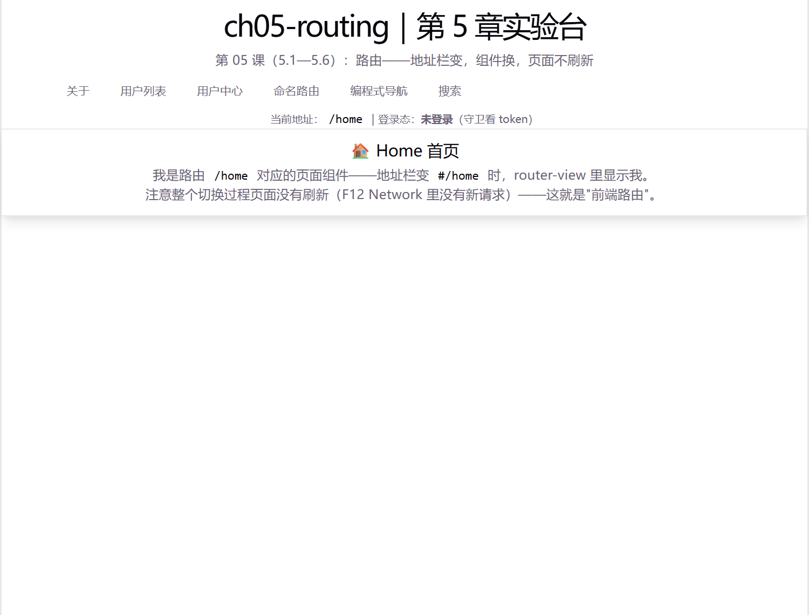
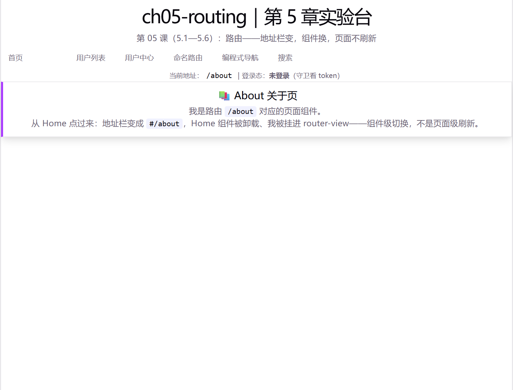
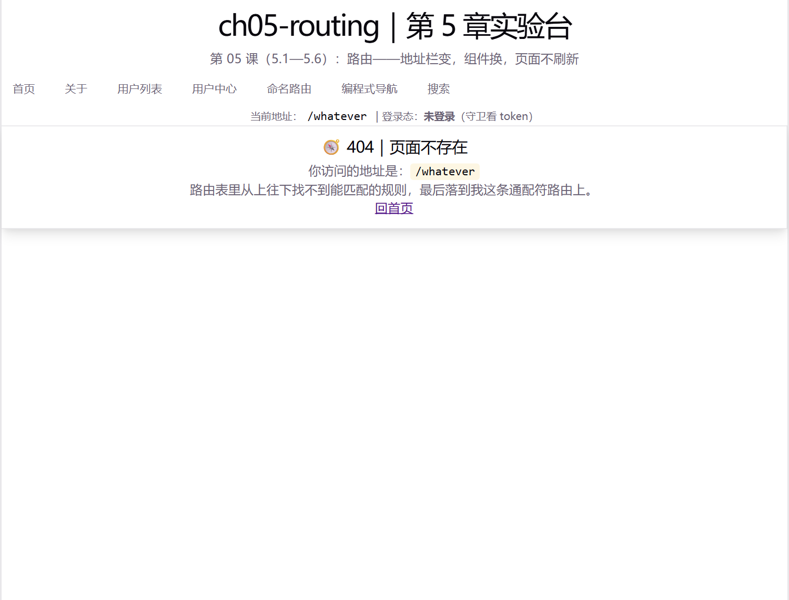
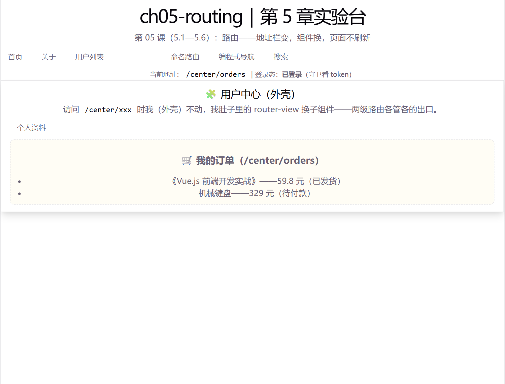
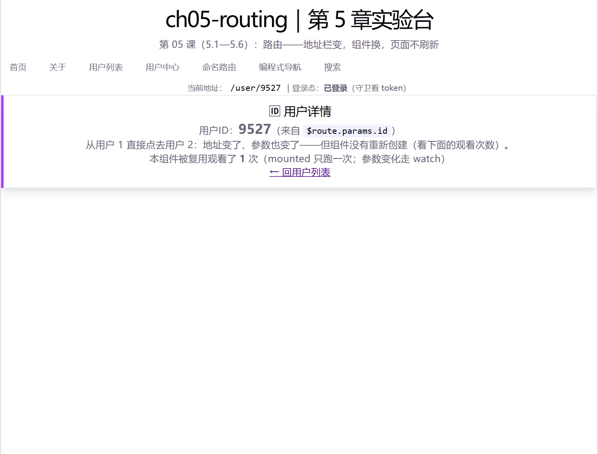
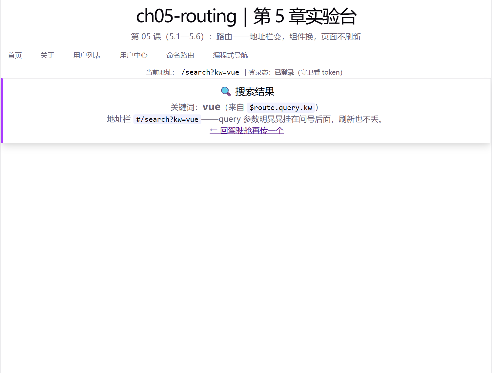
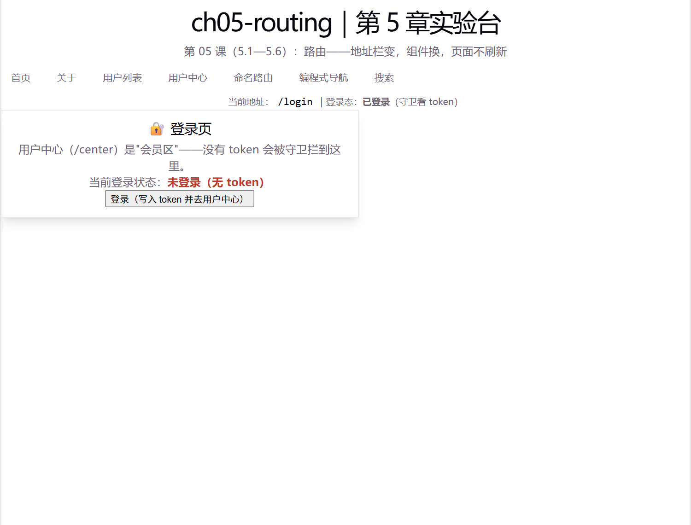

# 第 05 课：路由——单页应用的"多页面" —— 从"锚点跳转"到"地址栏驱动"（5.1—5.6）

| 项目 | 内容 |
|---|---|
| 课程 | WEB 前端框架技术（203051）· 2026—2027 学年第一学期 · 2024 级计算机科学与技术 |
| 本课学时 | **4 学时（180 分钟）**：上半场 90′ + 课间 10′ + 下半场 90′，**以实验任务流为主线**，知识点在做中穿插讲 |
| 教材 | 《Vue.js 前端开发实战（第 2 版）》黑马程序员，人民邮电出版社 · **第 5 章路由 5.1—5.6（书页 117—141，本次扫描件核实）** |
| 对应教案单元 | 第 21—24 学时（第 5 章路由）——按课程节奏随第 5 次课（学时 17—20）推进 |
| 对应实验 | 章节实验 **`ch05-routing`**（《[00-项目目录与命名规范](../实验指导/00-项目目录与命名规范.md)》4.1 章节实验代号表）：进章新建一次 + 小实验 01—07 |
| 对应大纲 | 实验项目 9「路由基础」+ 实验项目 10「嵌套路由动态路由与命名路由」+ 实验项目 11「编程式导航与导航守卫」（历史代号 lab09—lab11，见《00-规范》4.2） |
| 贯穿项目 | notes-app **本课课堂不动**——综合作业继续在课后长：给笔记应用装上真正的路由页签（见任务 8 作业表） |
| 前置检查 | ch04-dynamic-slots 提交已推送；notes-app 插槽化综合作业完成（NoteCard 插槽版能跑）；第 4 章动态组件的概念还热着——今天 `<router-view>` 就是"官方版动态组件" |

> **本课怎么上**：前四章的应用都是"一屏到底"，想看别的内容要么滚页面、要么切锚点。今天给应用装**地址栏驱动的多页面**：URL 变、组件换、页面不刷新——这就是**前端路由**，SPA（单页应用）的骨架。组织方式仍是一章一个大实验：上半场建 **ch05-routing**，从零接入 vue-router、配出第一批页面、玩转重定向与动态路由；下半场嵌套、命名、编程式导航、路由守卫四连收尾。三个约定不变：① 选项式主线（好消息：**第 5 章教材本身就是选项式 `this.$router` / `$route` 口径**，本课几乎没有"双轨对照"负担）；② 每任务附 **🐣 初学者卡点表**；③ 命令统一 **CMD**、提交 `ch05-routing-学号`、截图 `ch05-序号-说明.png`。
>
> ⏱️ **节奏提示（师生共勉）**：本课的"实验台"不再是锚点菜单，而是**路由导航栏**——每做完一个实验，导航就"点亮"一格。router/index.js 是全章唯一持续长大的文件，每一步增量都给"修改前 → 修改后"对照，**照着敲、别跳步**。

---

## 目录

**上半场（学时 17—18）：第 5 章大实验 ch05-routing —— 装路由 · 配页面 · 动起来**

- [任务 0｜开场三步 + 新建 ch05-routing + 安装 vue-router（12′）](#t50)
- [任务 1｜小实验 01：基础路由——五步接入 + 页面切换（5.2.1—5.2.2）（25′）](#t51)
- [任务 2｜小实验 02：重定向与 404 兜底（5.2.3 前半）（13′）](#t52)
- [任务 3｜小实验 03：动态路由 :id 与 \$route.params（5.2.3 后半）（20′）](#t53)
- [上半场收尾｜提交 ch05-routing（上半场版）（5′）](#t5c)
- 课间 10′

**下半场（学时 19—20）：ch05-routing（续）—— 嵌套 · 命名 · 编程式 · 守卫**

- [任务 4｜小实验 04：嵌套路由 children（5.3）（18′）](#t54)
- [任务 5｜小实验 05：命名路由 name + params（5.4）（12′）](#t55)
- [任务 6｜小实验 06：编程式导航 push / replace / query（5.5）（25′）](#t56)
- [任务 7｜小实验 07：路由守卫 beforeEach 登录拦截（5.6）（22′）](#t57)
- [任务 8｜教材案例与习题映射 + 提交 + 课末收尾（13′）](#t5w)（知识树、术语速查表、知识地图、课堂五问、作业与预告）
- [跟练进度自检清单（可打印）](#t5ck)

**附录**

- [附录 A｜任务流与教案、章节实验、教材的对应关系](#t5a)
- [附录 B｜教材 ↔ 本地实测环境差异对照表](#t5b)
- [附录 C｜参考资料](#t5cc)

> **符号图例**（同第 02—04 课）：✏️ = 增量片段（`＋` 新增行 / `✱` 修改行）｜ 📄 = 对账用完整快照 ｜ ✍️ = **挖空补全版**（骨架完整，`______` 处自己写；行尾 `// 补全：…` 是提示）｜ 📌 = 对照效果图 ｜ 📖 = 教材写法对照 / 认知卡 ｜ 🐣 = 初学者卡点表 ｜ ✅ = 检查点
>
> ✍️ **本课学习模式（新）**：实验代码不再"照抄整块"——课件给出**带完整注释的骨架**，核心行挖成 `______`。流程：**先读注释看懂骨架 → 对照本任务【讲】的知识点把空补全 → 运行看 ✅检查点 → 过不了回卡点表对号**。挖空只挖"本实验教的那几行"，页面样板代码（样式、纯展示模板）保持完整；实在补不出来，看教师机的 📌 效果图或直接问。

---

## 〇、上课前 3 分钟：先对齐"环境事实"

机房环境与上次课一致（实测：Node v22.23.2 / npm 10.9.8 / Vite 8.3.x / Vue 3.5.x）。本课新增的事实与预警（据教材第 5 章扫描件书页 117—141 核实）：

> ⚠️ **四处"教材 ↔ 课程"口径预警**：
> 1. **教材示例项目是 `D:\vue\chapter05`、页面组件放 `src\components\`**——课程固定走章节实验口径：`labs\ch05-routing\`，**路由页面组件放 `src\views\NN-节短名\`**（views 是路由生态的通用叫法，"一地址一视图"），本课首次用 views 替代 experiments，理由课上讲；
> 2. **教材第 5 章组件代码是选项式**（`this.$router.push()` / `$route.params`）——与课程主线**天然一致**，前几章的 📖 双轨对照本课基本不需要；
> 3. **教材用 hash 模式**（`createWebHashHistory()`，地址带 `#`）——课程照用；另一种 history 模式（`createWebHistory()`，无 `#` 但部署要配服务器）见 📖 认知卡，本课不展开；
> 4. **vue-router 必须单独安装**（`npm install vue-router@4`，实测装到 4.6.4）——它不随 Vite 的 Vue 模板自带；`@4` 是大版本号，和 Vue 3 配套（Vue 2 配 vue-router 3，别装错）。

### 本章地图：一章 = 一个大实验（第 5 章的划分）

| | 完整实验项目（`labs\` 下，新建一次） | 章内小实验（`src\views\NN-节短名\`） | 课内时机 | 提交 / 截图代号 |
|---|---|---|---|---|
| 第 5 章（5.1—5.6） | `ch05-routing` | 01-basic · 02-redirect · 03-dynamic · 04-nested · 05-named · 06-programmatic · 07-guard | 上半场 01—03，下半场 04—07 | `ch05-routing` |

目录树速览：

```
labs\ch05-routing\
├── src\
│   ├── App.vue                 ← 实验台：导航栏 router-link + 唯一出口 router-view
│   ├── main.js                 ← createApp(App).use(router).mount('#app')
│   ├── style.css               ← 课程设计令牌（从 ch04 复制）
│   ├── router\
│   │   └── index.js            ← 路由表 + 守卫（全章唯一、逐实验长大的文件）
│   └── views\
│       ├── 01-basic\           ← 5.2.1—5.2.2 Home / About
│       ├── 02-redirect\        ← 5.2.3 前半 NotFound（404）
│       ├── 03-dynamic\         ← 5.2.3 后半 Users / User（:id）
│       ├── 04-nested\          ← 5.3 Center + CenterProfile / CenterOrders
│       ├── 05-named\           ← 5.4 NamedDemo
│       ├── 06-programmatic\    ← 5.5 ProgramDemo / Search（query）
│       └── 07-guard\           ← 5.6 Login（守卫搭档）
└── package.json
```

> 💡 **和第 4 章"实验台"的差别**：ch02—ch04 的实验台是**锚点菜单**（`<a href="#exp-01">`，跳完还在同一页）；本章换成**路由导航**（`<router-link>`，地址栏就是实验记录仪）——这个换代本身就是本课第一个知识点。

---

## 一、本节课流程总览（4 学时 · 以实验任务为主线）

### 上半场（学时 17—18，90′）：ch05-routing —— 装路由 · 配页面 · 动起来

| # | 实验任务（主线） | 穿插知识点 | 时间 | 小实验目录 |
|---|---|---|---|---|
| 0 | 开场三步 + 新建 ch05-routing + 安装 vue-router | 5.1 概念 · 5.2.1 安装 | 12′ | 项目骨架 |
| 1 | 基础路由：五步接入 + Home/About 切换 | **5.2.2 全流程** | 25′ | 01-basic |
| 2 | 重定向 + 404 兜底 | **5.2.3 前半** | 13′ | 02-redirect |
| 3 | 动态路由 :id + 取参 + 组件复用 | **5.2.3 后半** | 20′ | 03-dynamic |
| 4 | 提交 ch05-routing（上半场版） | Git 节奏 | 5′ | —— |

**课间 10′**（dev 服务器不关；离开座位请锁屏 `Win + L`）

### 下半场（学时 19—20，90′）：ch05-routing（续）—— 嵌套 · 命名 · 编程式 · 守卫

| # | 实验任务（主线） | 穿插知识点 | 时间 | 小实验目录 |
|---|---|---|---|---|
| 5 | 嵌套路由：外壳 + children 两级出口 | **5.3** | 18′ | 04-nested |
| 6 | 命名路由：name + params 解耦 | **5.4** | 12′ | 05-named |
| 7 | 编程式导航：push / replace / query | **5.5** | 25′ | 06-programmatic |
| 8 | 路由守卫：beforeEach 登录拦截 | **5.6** | 22′ | 07-guard |
| 9 | 教材习题映射 + 提交 + 课末收尾 | **5.7** | 13′ | —— |

（教师参考：本课全部代码已实测跑通，完整可运行版存于 [web-framework-2024xxxx/ch05-routing](../web-framework-2024xxxx/ch05-routing/)，21 项自动断言全部通过（重定向 / 404 / 动态参数 / 组件复用 / 嵌套切换 / query 传参 / push 与 replace 的历史差异 / 守卫拦截—放行—再拦截）；真实截图存于 [第05课效果图](./第05课效果图/)：ch05-01—ch05-09 共 9 张。）

---

# 上半场（学时 17—18）：第 5 章大实验 ch05-routing

<a id="t50"></a>

## 任务 0｜开场三步 + 新建 ch05-routing + 安装 vue-router（12 分钟）

### 【讲】先弄明白：什么是路由（5.1，教材 117—119 页）

**后端路由**（早期网站）：**URL ↔ 服务器上的真实资源**一一对应——地址栏一变就向服务器发请求，服务器返回**整个新页面**。每次切换都整页刷新、服务器压力山大。
**前端路由**（本课主角）：**URL ↔ 页面里的组件**一一对应——地址栏变了，由前端 JS 换组件，**不向服务器要页面、不整页刷新**。这就是 SPA（单页应用）：整个网站其实只有一个 HTML，"翻页"全是换组件。

> ❓ **课堂设问**：我们已经会"换组件"了——第 4 章的 `<component :is>` 就是。那路由比它强在哪？（① 地址栏同步——可收藏、可分享、可后退；② 导航/守卫/传参一整套机制。今天就把第 4 章手搓的页签升级成"官方版"。）

### 【做】第 1 步：开场三步 + 进章建项目

```bat
rem ① 回课程仓库 → ② 拉取远程 → ③ 进 labs 建第 5 章完整实验项目
cd /d D:\web-framework-2024xxxx
git pull
cd labs
npm create vite@latest ch05-routing
rem 交互选择与第 01 课相同：Framework → Vue ｜ Variant → JavaScript
cd ch05-routing
npm install
```

### 【做】第 2 步：安装 vue-router（5.2.1，教材 120 页）

```bat
rem 仍在 labs\ch05-routing 目录下；@4 指定大版本（Vue3 配 vue-router 4）
npm install vue-router@4
```

装完看一眼 `package.json` 的 dependencies：`"vue-router": "^4.6.4"`（本机实测版本）——**依赖里多了一员，本课的主角进场**。

### 【做】第 3 步：清脚手架 + 复用设计令牌 + 最小 App.vue

```bat
del src\components\HelloWorld.vue
copy /y ..\ch04-dynamic-slots\src\style.css src\style.css
```

**📄 `src/App.vue`｜整体替换（任务 0 阶段版：还没有任何路由元素）：**

```vue
<template>
  <div id="app">
    <h1>ch05-routing｜第 5 章实验台</h1>
    <p class="muted">路由尚未接入——任务 1 点灯。</p>
  </div>
</template>

<script>
export default {
  name: 'App'
}
</script>
```

```bat
rem 第 4 步：启动（此刻是普通 Vue 应用，还没有路由）
npm run dev
```

✅ **检查点 0**：页面出标题、"路由尚未接入"；`package.json` 里有 vue-router；F12 Console 干净（HelloWorld 已删、无报错）。

---

<a id="t51"></a>

## 任务 1｜小实验 01：基础路由——五步接入 + 页面切换（5.2.1—5.2.2）（25 分钟）

### 【讲】接入路由的官方五步（教材 5.2.2"路由的使用流程"，书页 121—123）

① 建 `src/router/index.js` → ② `createRouter` 创建路由器 → ③ `routes` 数组配规则 → ④ `main.js` 里 `use(router)` → ⑤ App.vue 里放 `<router-link>` + `<router-view>`。五步做完，应用从"一屏到底"变成"地址驱动"。

### 【做】第 1 步：两个页面组件

```bat
mkdir src\views\01-basic
```

**✏️ `src/views/01-basic/Home.vue`｜新建文件（完整·纯展示样板，照抄即可）：**

```vue
<!-- ============================================================
  Home.vue —— 实验 01 页面：首页（5.2.2）
  目录：views/01-basic/
  要点：最普通的一个路由页面组件，没有任何路由专属代码
============================================================ -->
<template>
  <div class="page">
    <h2>🏠 Home 首页</h2>
    <p>我是路由 <code>/home</code> 对应的页面组件——地址栏变 <code>#/home</code> 时，router-view 里显示我。</p>
    <p class="muted">注意整个切换过程页面没有刷新（F12 Network 里没有新请求）——这就是"前端路由"。</p>
  </div>
</template>

<script>
export default {
  name: 'Home'
}
</script>

<style scoped>
.page {
  background: var(--card, #fff);
  border: 1px solid var(--border);
  border-left: 4px solid var(--primary);
  border-radius: var(--radius);
  box-shadow: var(--shadow);
  padding: 14px 18px;
}

code {
  background: var(--primary-bg);
  border-radius: 4px;
  padding: 0 6px;
  font-family: Consolas, Monaco, monospace;
}

.muted {
  color: var(--muted);
}
</style>
```

**✏️ `src/views/01-basic/About.vue`｜新建文件（完整·纯展示样板，照抄即可）：**

```vue
<!-- ============================================================
  About.vue —— 实验 01 页面：关于页（5.2.2）
  目录：views/01-basic/
  要点：与 Home 同构——证明"换地址 = 换组件"，页面本身无感
============================================================ -->
<template>
  <div class="page">
    <h2>📚 About 关于页</h2>
    <p>我是路由 <code>/about</code> 对应的页面组件。</p>
    <p>从 Home 点过来：地址栏变成 <code>#/about</code>，Home 组件被卸载、我被挂进 router-view——组件级切换，不是页面级刷新。</p>
  </div>
</template>

<script>
export default {
  name: 'About'
}
</script>

<style scoped>
.page {
  background: var(--card, #fff);
  border: 1px solid var(--border);
  border-left: 4px solid var(--accent);
  border-radius: var(--radius);
  box-shadow: var(--shadow);
  padding: 14px 18px;
}

code {
  background: #f0f1ff;
  border-radius: 4px;
  padding: 0 6px;
  font-family: Consolas, Monaco, monospace;
}
</style>
```

### 【做】第 2 步：创建路由器（步骤①②③）

**✍️ `src/router/index.js`｜新建文件（挖空补全版：把三处 `______` 填上）：**

```js
// ============================================================
// router/index.js —— ch05-routing 路由表（全章唯一，逐实验长大）
// 创建：createRouter + createWebHashHistory（hash 模式，地址带 #）
// 挂载：main.js 里 app.use(router) 之后，全项目才有 router-link/router-view
// ============================================================
// 从 vue-router 包里"取工具"：createRouter 造路由器、createWebHashHistory 造 hash 历史
import { createRouter, createWebHashHistory } from 'vue-router'

// 页面组件就是普通 .vue 文件，谁要上路由舞台，谁就要先被 import 进来
import Home from '../views/01-basic/Home.vue'
import About from '../views/01-basic/About.vue'

const router = createRouter({
  history: ______,   // 补全：hash 模式的历史记录（调用那个工厂函数，记得加括号）
  routes: [
    // 一条规则 = 一个对象：path 是地址（以 / 开头）、component 是页面组件
    { path: ______, component: ______ },   // 补全：地址 /home 配 Home 组件
    { path: ______, component: ______ }    // 补全：地址 /about 配 About 组件
  ]
})

export default router
```

### 【做】第 3 步：main.js 挂载路由（步骤④）

**✍️ `src/main.js`｜两处增量（＋ 为新增，其中一处挖空）：**

修改前：

```js
import { createApp } from 'vue'
import './style.css'
import App from './App.vue'

createApp(App).mount('#app')
```

修改后：

```js
import { createApp } from 'vue'
import './style.css'
import App from './App.vue'
＋import router from './router'
＋
 createApp(App).use(______).mount('#app')   // 补全：把上面 import 的路由器实例交给应用
```

`use(router)` 之后，`<router-link>` 和 `<router-view>` 才是全项目"认识"的组件——**不需要 import、不需要注册**（和第 4 章 KeepAlive 一样的"官方内置"待遇）。

### 【做】第 4 步：App.vue 换导航实验台（步骤⑤）

**✍️ `src/App.vue`｜整体替换（挖空补全版：导航给了前两个作样例，其余五格 + 出口自己补）：**

```vue
<!-- ============================================================
  App.vue —— ch05-routing 第 5 章实验台（路由版）
  上一章的实验台是"锚点菜单"，这一章换成 router-link 导航：
  导航栏 + 唯一出口 <router-view>，地址栏就是实验记录仪。
  注意：router-link/router-view 没有 import、没注册——
  它们是 app.use(router) 之后全局可用的"官方组件"。
============================================================ -->
<template>
  <div id="app">
    <h1>ch05-routing｜第 5 章实验台</h1>
    <p class="muted">第 05 课（5.1—5.6）：路由——地址栏变，组件换，页面不刷新</p>

    <nav class="top-nav">
      <!-- router-link = 会走路由的 <a>：to 写目标地址（别忘引号）；渲染后自动带高亮类 -->
      <router-link to="/home">首页</router-link>
      <router-link to="/about">关于</router-link>
      <router-link to="______">用户列表</router-link>      <!-- 补全：地址见任务 3 -->
      <router-link to="______">用户中心</router-link>      <!-- 补全：地址见任务 4 -->
      <router-link to="______">命名路由</router-link>      <!-- 补全：地址见任务 5 -->
      <router-link to="______">编程式导航</router-link>    <!-- 补全：地址见任务 6 -->
      <router-link to="______">搜索</router-link>          <!-- 补全：地址见任务 6 -->
    </nav>

    <!-- $route.fullPath = 当前完整地址——地址栏的"回声"，实验时盯它 -->
    <p class="muted addr">当前地址：<code>{{ $route.fullPath }}</code>｜登录态：<b>{{ $route.path === '/login' || isLogin() ? '已登录' : '未登录' }}</b>（守卫看 token）</p>

    <!-- 补全：唯一的顶层路由出口组件（一对标签）——地址匹配到谁，谁就显示在这里 -->
    <______></______>
  </div>
</template>

<script>
export default {
  name: 'App',
  methods: {
    // 用方法不用 computed：localStorage 不是响应式数据，computed 没有响应式依赖会被缓存成"旧值"；
    // 方法每次渲染都重查——路由一变页面重渲染，登录态跟着刷新
    isLogin() {
      return !!localStorage.getItem('token')
    }
  }
}
</script>

<style scoped>
.top-nav {
  display: flex;
  flex-wrap: wrap;
  gap: 10px;
  margin: 12px 0 8px;
}

.top-nav a {
  color: var(--primary-dark);
  text-decoration: none;
  border: 1px solid var(--primary);
  border-radius: 999px;
  padding: 3px 14px;
  font-size: 14px;
}

.top-nav a:hover {
  background: var(--primary-bg);
}

/* router-link 匹配当前地址时自动带上 router-link-active 类——白送的高亮 */
.top-nav a.router-link-active {
  background: var(--primary);
  color: #fff;
}

.addr {
  font-size: 13px;
}

code {
  background: var(--primary-bg);
  border-radius: 4px;
  padding: 0 6px;
  font-family: Consolas, Monaco, monospace;
}

.muted {
  color: var(--muted);
  margin-top: 0;
}
</style>
```

> 💡 五个挖空的导航地址**现在补不出来是正常的**——它们的路由规则要到任务 3—6 才逐个配，学到哪个任务回来补哪格。此刻只有"首页/关于"两格能亮；点了还没配的地址，Console 有 `No match found` 警告——不是坏了，是**待点亮**。每做一个实验，路由表加一条规则、导航补一格地址，导航就亮一格。

### 【实验】基础路由三连看

1. 点"首页"/"关于"来回切：**地址栏** `#/home` ↔ `#/about` 变、**router-view** 里组件换、**Network 面板零新请求**（前端路由的铁证）；
2. 盯导航：当前页对应的胶囊**自动高亮**——`router-link` 匹配地址时自动加 `router-link-active` 类，样式白送；
3. 试试浏览器**后退**按钮：能回上一个地址——路由历史被接管了。

📖 **认知卡：router-link 渲染成了什么？**——打开 F12 Elements 看导航：`<router-link>` 渲染成了 `<a href="#/home">`。它拦截了点击、改由路由接管，所以**不会整页刷新**——这是它和普通 `<a>` 的本质区别。

📌 对照图 01/02（Home 与 About 两页 + 导航高亮）：





✅ **检查点 1**：两页切换流畅、地址栏同步、无网络请求；能说出五步顺序（建 router → createRouter → 配 routes → use → link/view）；导航高亮是 `router-link-active` 干的。

### 🐣 初学者卡点 1（基础路由）

| 现象 | 原因 | 解决 |
|---|---|---|
| 页面报 "Failed to resolve component: router-link" | `main.js` 忘了 `.use(router)`，或 router/index.js 没建/没 export | 对账 main.js 两处增量；router/index.js 末尾 `export default router` |
| 地址栏是 `#/home` 页面却空白 | 规则里 `path: '/home'` 写成了 `home`（少斜杠）或大小写不符 | path 一律以 `/` 开头，和 `<router-link to>` 逐字符对上 |
| 点导航整页刷新了 | 用了普通 `<a href="#/home">` 而不是 `<router-link>` | 导航必须 router-link；a 标签触发的是浏览器原生跳转 |
| 改了 router/index.js 不生效 | 依赖热更新偶发失灵 / import 路径大小写错 | 保存后刷新页面；Windows 本地大小写不敏感但 Vite 构建敏感，路径按文件名原样写 |
| Console 警告 No match found for path "/users" | 导航七格里还有没配的地址（任务 2—7 逐个点亮） | 属预期现象，不是报错；配完该规则警告即消失 |

---

<a id="t52"></a>

## 任务 2｜小实验 02：重定向与 404 兜底（5.2.3 前半）（13 分钟）

### 【讲】两个高频配置项（教材 123—124、126 页）

**重定向 `redirect`**：应用打开时地址是 `/`（什么都没配）——配一条 `{ path: '/', redirect: '/home' }`，访问根路径自动跳 `/home`，"首页"有了着落。
**404 兜底 `:pathMatch(.*)*`**：用户手滑输错地址（`#/whatever`）没有规则能匹配——通配符规则**兜住一切没配置的地址**，显示友好的 404 页。**必须放 routes 数组最后**：路由匹配是**从上往下、先到先得**，通配符放前面会把所有地址都劫走。

### 【做】NotFound 页面 + 路由表两处增量

```bat
mkdir src\views\02-redirect
```

**✏️ `src/views/02-redirect/NotFound.vue`｜新建文件（完整·纯展示样板，照抄即可）：**

```vue
<!-- ============================================================
  NotFound.vue —— 实验 02 页面：404 兜底页（5.2.3）
  目录：views/02-redirect/
  要点：通配符路由 :pathMatch(.*)* 兜住一切没配置的地址；
        必须放在 routes 数组最后（从上往下匹配，先到先得）
============================================================ -->
<template>
  <div class="page">
    <h2>🧭 404｜页面不存在</h2>
    <p>你访问的地址是：<code>{{ $route.fullPath }}</code></p>
    <p class="muted">路由表里从上往下找不到能匹配的规则，最后落到我这条通配符路由上。</p>
    <router-link to="/home">回首页</router-link>
  </div>
</template>

<script>
export default {
  name: 'NotFound'
}
</script>

<style scoped>
.page {
  background: var(--card, #fff);
  border: 1px solid var(--border);
  border-left: 4px solid var(--warn);
  border-radius: var(--radius);
  box-shadow: var(--shadow);
  padding: 14px 18px;
}

code {
  background: #fdf6e3;
  border-radius: 4px;
  padding: 0 6px;
  font-family: Consolas, Monaco, monospace;
}

.muted {
  color: var(--muted);
}
</style>
```

**✍️ `src/router/index.js`｜两处增量（＋ 为新增，两条新规则挖空自己补）：**

改动①：import 区加一行（在 About 的 import 之后）：

```js
＋import NotFound from '../views/02-redirect/NotFound.vue'
```

改动②：routes 数组——修改前：

```js
  routes: [
    // 一条规则 = 一个地址配一个组件：path 是地址、component 是页面
    { path: '/home', component: Home },
    { path: '/about', component: About }
  ]
```

修改后（`/` 放最前、通配符放最后，中间是普通规则）：

```js
  routes: [
    // 根路径重定向：打开 / 自动跳 /home（放在最前，第一时间接管）
    // redirect 的值是"要跳去的目标地址字符串"，不是组件！
＋  { path: '______', redirect: '______' },   // 补全：根路径 / → 跳去 /home
    // 一条规则 = 一个地址配一个组件：path 是地址、component 是页面
    { path: '/home', component: Home },
    { path: '/about', component: About },
    // 404 兜底：通配符必须放最后——从上往下匹配，先到先得（照【讲】抄一遍，体会两个星号）
＋  { path: '______', name: 'NotFound', component: NotFound }   // 补全：通配符地址（见上方【讲】）
  ]
```

### 【实验】两个地址各试一次

1. 地址栏手输 `http://localhost:5173/` 回车 → 自动变 `#/home`（重定向）；
2. 手输 `http://localhost:5173/#/whatever` 回车 → 404 页显示"你访问的地址是：/whatever"，点"回首页"能回去。

📌 对照图 03：



✅ **检查点 2**：根路径自动跳 /home；任意乱地址落 404 且能回首页；能说出"通配符为什么必须放最后"。

### 🐣 初学者卡点 2（重定向与 404）

| 现象 | 原因 | 解决 |
|---|---|---|
| 打开首页直接 404 | 通配符规则写在了 `/` 或 `/home` **前面**，把一切地址都劫走了 | 调整顺序：redirect 在最前、普通规则居中、通配符殿后 |
| redirect 写成 `component: Home` | 把"跳转"当成了"渲染" | redirect 的值是**目标地址字符串**（`'/home'`），不是组件 |
| 通配符照抄报语法错 | `/:pathMatch(.*)*` 里的点、星号抄漏或写成中文括号 | 逐字符照抄（英文括号、点星号）；它本质是"参数化的正则" |
| 手输 #/whatever 地址栏自动清掉 | 输的地址没带 `#`（hash 模式的分界符） | hash 模式下手输完整地址：`http://localhost:5173/#/whatever` |

---

<a id="t53"></a>

## 任务 3｜小实验 03：动态路由 :id 与 $route.params（5.2.3 后半）（20 分钟）

### 【讲】知识点 1：一条规则匹配一整族地址（教材 124—125 页）

**一句话定义**：动态路由 = 在 path 里用 **`:参数名` 占位**，一条规则匹配一整族地址——`/user/:id` 匹配 `/user/1`、`/user/2`、`/user/9527`…
**类比**：`:id` 像**填空题的空格**——规则是"用户编号是___的用户页"，地址栏来填空。
**取参**：组件里用 **`$route.params.id`** 拿到地址里填的值（`$route` = 当前路由信息对象；对比第 04 章的 `$refs`——都是"this 上的官方工具"）。

**传参三种写法**（都会用到，模板里按需选）：

```html
<router-link to="/user/1">写法① 字符串写死</router-link>
<router-link :to="'/user/' + id">写法② 拼变量（注意 :to 与引号）</router-link>
<router-link :to="{ path: '/user/9527' }">写法③ 对象 path</router-link>
```

### 【做】Users 列表页 + User 详情页 + 路由表增量

```bat
mkdir src\views\03-dynamic
```

**✍️ `src/views/03-dynamic/Users.vue`｜新建文件（挖空补全版：写法①是样例，②③自己补）：**

```vue
<!-- ============================================================
  Users.vue —— 实验 03 页面：用户列表（5.2.3 动态路由入口）
  目录：views/03-dynamic/
  要点：一个规则 /user/:id 匹配 /user/1、/user/2、/user/9527 …
        三种传参写法：字符串拼接 / :to 对象 / 命名路由（5.4 预告）
============================================================ -->
<template>
  <div class="page">
    <h2>👥 用户列表</h2>
    <p class="muted">路由规则只有一条 <code>/user/:id</code>，却能匹配下面所有用户页——:id 是"占位符"。</p>

    <ul class="user-list">
      <li>
        <!-- 样例：to 直接写死字符串地址 -->
        <router-link to="/user/1">写法① 字符串：用户 1</router-link>
      </li>
      <li>
        <!-- 补全：:to 动态绑定，把 data 里的 id 拼进地址（提示：'/user/' + id） -->
        <router-link :to="______">写法② 拼接变量：用户 {{ id }}（id 在 data 里）</router-link>
      </li>
      <li>
        <!-- 补全：对象写法，path 字段写完整地址 '/user/9527' -->
        <router-link :to="______">写法③ 对象 path：用户 9527</router-link>
      </li>
    </ul>

    <p class="muted">点任意一个：地址栏变 <code>#/user/几</code>，右侧 User 页显示"用户ID：几"。</p>
  </div>
</template>

<script>
export default {
  name: 'Users',
  data() {
    return { id: 2 }
  }
}
</script>

<style scoped>
.page {
  background: var(--card, #fff);
  border: 1px solid var(--border);
  border-left: 4px solid var(--primary);
  border-radius: var(--radius);
  box-shadow: var(--shadow);
  padding: 14px 18px;
}

.user-list {
  list-style: none;
  padding: 0;
  margin: 8px 0;
}

.user-list li {
  border-bottom: 1px dashed var(--border);
  padding: 6px 2px;
}

code {
  background: var(--primary-bg);
  border-radius: 4px;
  padding: 0 6px;
  font-family: Consolas, Monaco, monospace;
}

.muted {
  color: var(--muted);
}
</style>
```

**✍️ `src/views/03-dynamic/User.vue`｜新建文件（挖空补全版：取参两处 + watch 一处）：**

```vue
<!-- ============================================================
  User.vue —— 实验 03 页面：用户详情（5.2.3 动态路由取参）
  目录：views/03-dynamic/
  要点：$route.params.id 取动态参数；从 /user/1 点到 /user/2
        是"同一个组件复用"，需要 watch 路由才能响应参数变化
============================================================ -->
<template>
  <div class="page">
    <h2>🆔 用户详情</h2>
    <!-- 补全：当前路由信息对象 → 路径参数集合 → 名叫 id 的那个（问路用 $route，不是 $router） -->
    <p>用户ID：<b class="big">{{ ______ }}</b>（来自 <code>$route.params.id</code>）</p>
    <p class="muted">从用户 1 直接点去用户 2：地址变了、参数也变了——但组件没有重新创建（看下面的观看次数）。</p>
    <p>本组件被复用观看了 <b>{{ viewed }}</b> 次（mounted 只跑一次；参数变化走 watch）</p>
    <router-link to="/users">← 回用户列表</router-link>
  </div>
</template>

<script>
export default {
  name: 'User',
  data() {
    return { viewed: 1 }
  },
  mounted() {
    console.log('User 组件挂载了：', this.$route.params.id)
  },
  watch: {
    // 同一组件复用时，params 变化不会重挂组件——要自己侦听
    // 补全：侦听键写成字符串（提示：'$route.params.id'，引号别丢）
    ______(newId) {
      console.log('参数变了：', newId)
      this.viewed++
    }
  }
}
</script>

<style scoped>
.page {
  background: var(--card, #fff);
  border: 1px solid var(--border);
  border-left: 4px solid var(--accent);
  border-radius: var(--radius);
  box-shadow: var(--shadow);
  padding: 14px 18px;
}

.big {
  font-size: 22px;
  color: var(--primary-dark);
}

code {
  background: #f0f1ff;
  border-radius: 4px;
  padding: 0 6px;
  font-family: Consolas, Monaco, monospace;
}

.muted {
  color: var(--muted);
}
</style>
```

**✍️ `src/router/index.js`｜两处增量（＋ 为新增，动态段挖空自己补）：**

改动①：import 区加两行：

```js
＋import Users from '../views/03-dynamic/Users.vue'
＋import User from '../views/03-dynamic/User.vue'
```

改动②：routes 数组里、`/about` 规则**之后**加（＋ 为新增）：

```js
    { path: '/about', component: About },
    // 动态路由：:id 是占位符，一条规则匹配 /user/1、/user/2、/user/9527…
＋  { path: '/users', component: Users },
＋  { path: '/user/______', component: User },   // 补全：参数占位符（冒号开头，名字与取参一致）
    // 404 兜底……（原有内容不动）
```

### 【实验】三连验证 + 一个"惊天秘密"

1. 点列表页三个链接：地址 `#/user/1`、`#/user/2`、`#/user/9527`，页面"用户ID"跟着变——**一条规则服务一整族页面**；
2. F12 Console：每次从列表进入 User，打印一次 `User 组件挂载了： 几`；
3. **惊天秘密**：在地址栏把 `#/user/1` 改成 `#/user/2` 直接回车（**不经过列表页**）——页面数字变了，但 Console **没有**新的"挂载了"，"观看次数"变 2——**同一个组件被复用，没有重新创建**！

### 【讲】知识点 2：组件复用与 watch 路由（本课最重要的坑）

`/user/1` → `/user/2` 前后用的是**同一个 User 组件**，Vue 出于性能**不会卸载重建**它——`mounted` 只在第一次跑，之后**参数变化只能靠 watch**：

```js
watch: {
  '$route.params.id'(newId) { /* 参数变了，自己刷新数据 */ }
}
```

实测控制台对照（本机原文）：

```
User 组件挂载了： 1     ← 从列表进入（真挂载）
参数变了： 2           ← /user/1 直达 /user/2（复用，只走 watch）
```

真实项目里"进入用户页要发请求拿数据"的写法：**mounted 里发一次 + watch 里参数变了再发**，两处都要写。

📌 对照图 04：


✅ **检查点 3**：三种传参写法都点过；`$route.params.id` 能口述；"直达改地址不重挂组件、要 watch"这个现象亲眼见过并能解释。

### 🐣 初学者卡点 3（动态路由）

| 现象 | 原因 | 解决 |
|---|---|---|
| 页面显示"用户ID："后面是空的 | path 写成 `/user` 没带 `:id`，或取参写成 `$route.params.ID`（大小写） | 规则 `/user/:id` 与取参 `$route.params.id` **逐字符对齐** |
| 写法② 点了跳到 `/user/` 报 404 | `:to` 少了冒号（当成字符串 `'/user/' + id` 拼了字面量）或 id 拼错 | `:to="'/user/' + id"`——外层单引号、冒号绑定，三层引号数清楚 |
| `/user/1` 直达 `/user/2` 页面数据不更新 | 以为组件会重建——实际是**同组件复用**，mounted 不再跑 | watch `'$route.params.id'`，变化时自己刷新 |
| `$route` 写成 `$router` | 两个都带 $，差一个字母天壤之别 | **$route = 问路（当前地址信息）**；**$router = 开车（跳转方法 push/replace）**——问路不开车 |
| 规则顺序把 `/users` 放在 `/user/:id` 后面也想匹配 | 顺序无碍但前缀撞车要小心：`/user/:id` 不会抢 `/users`（路径段完整匹配），但同前缀规则多的项目要注意先后 | 养成"具体在前、宽泛在后"的排序习惯 |

---

## 上半场收尾｜提交 ch05-routing（上半场版）（5 分钟）

```bat
cd /d D:\web-framework-2024xxxx
git add .
rem 上半场：第 5 章完整实验前半——01 基础路由 / 02 重定向与404 / 03 动态路由
git commit -m "ch05-routing-2024xxxx"
git push
```

📸 **截图留档**（存 `screenshots\`）：`ch05-01-basic-home.png`（基础两页+高亮）、`ch05-03-404.png`（404 兜底）、`ch05-04-dynamic.png`（动态路由取参）。

✅ **检查点 4**：`git log --oneline -3` 里 ch05-routing 在最上；`git status` 干净。

---

# 课间 10 分钟

（dev 服务器不关；离开座位请锁屏 `Win + L`。）

---

# 下半场（学时 19—20）：ch05-routing（续）—— 嵌套 · 命名 · 编程式 · 守卫

> 💡 **思政融入**（教案口径）：路由守卫是网络世界的"**门禁与安检**"——先验明身份再放行，正是工程安全里的**权限最小化**原则；而"地址即状态"的设计让知识可链接、可分享，是**信息开放共享**的互联网初心。

---

<a id="t54"></a>

## 任务 4｜小实验 04：嵌套路由 children（5.3）（18 分钟）

### 【讲】两级路由、两个出口（教材 127—129 页）

**一句话定义**：嵌套路由 = 在一条路由规则里用 **`children` 数组**再配子规则，页面里出现**第二级** `<router-view>`——外壳组件管布局，子组件在壳里的出口切换。
**类比**：顶层 router-view 是**商场的大门**（换商场=换整页）；子 router-view 是**商场里的店铺**——商场不动，换的只是店铺。
**规则写法两个硬口径**（教材 127 页原文示例）：① 子规则写在 `children: [...]` 里；② **子规则的 path 不带开头的 `/`**（`'profile'` 自动拼成 `/center/profile`）。

### 【做】外壳 + 两个子页 + 路由表增量

```bat
mkdir src\views\04-nested
```

**✍️ `src/views/04-nested/Center.vue`｜新建文件（挖空补全版：子出口自己补）：**

```vue
<!-- ============================================================
  Center.vue —— 实验 04 页面：用户中心外壳（5.3 嵌套路由）
  目录：views/04-nested/
  要点：外壳自带布局 + 自己的 <router-view>（子路由出口）；
        子路由地址 /center/profile、/center/orders 在外壳里切换
============================================================ -->
<template>
  <div class="page">
    <h2>🧩 用户中心（外壳）</h2>
    <p class="muted">访问 <code>/center/xxx</code> 时我（外壳）不动，我肚子里的 router-view 换子组件——两级路由各管各的出口。</p>

    <nav class="sub-nav">
      <router-link to="/center/profile">个人资料</router-link>
      <router-link to="/center/orders">我的订单</router-link>
    </nav>

    <!-- 补全：子路由出口组件（一对标签）——/center/profile 显示 CenterProfile、/center/orders 显示 CenterOrders -->
    <______></______>
  </div>
</template>

<script>
export default {
  name: 'Center'
}
</script>

<style scoped>
.page {
  background: var(--card, #fff);
  border: 1px solid var(--border);
  border-left: 4px solid var(--primary);
  border-radius: var(--radius);
  box-shadow: var(--shadow);
  padding: 14px 18px;
}

.sub-nav {
  display: flex;
  gap: 10px;
  margin: 10px 0;
}

.sub-nav a {
  color: var(--primary-dark);
  text-decoration: none;
  border: 1px solid var(--primary);
  border-radius: 999px;
  padding: 2px 14px;
  font-size: 14px;
}

.sub-nav a.router-link-active {
  background: var(--primary);
  color: #fff;
}

code {
  background: var(--primary-bg);
  border-radius: 4px;
  padding: 0 6px;
  font-family: Consolas, Monaco, monospace;
}

.muted {
  color: var(--muted);
}
</style>
```

**✏️ `src/views/04-nested/CenterProfile.vue`｜新建文件（完整·纯展示样板，照抄即可）：**

```vue
<!-- ============================================================
  CenterProfile.vue —— 实验 04 子页面：个人资料（5.3）
  目录：views/04-nested/
  要点：子路由组件，显示在 Center 外壳的 router-view 里
============================================================ -->
<template>
  <div class="sub-page">
    <h3>📄 个人资料（/center/profile）</h3>
    <p>姓名：张三｜求职意向：前端开发工程师</p>
    <p class="muted">我是 Center 的 child，地址 <code>/center/profile</code> 里开头的 <code>/center</code> 部分归外壳管。</p>
  </div>
</template>

<script>
export default {
  name: 'CenterProfile'
}
</script>

<style scoped>
.sub-page {
  border: 1px dashed var(--border);
  border-radius: 8px;
  background: #fffdf5;
  padding: 10px 14px;
}

code {
  background: var(--primary-bg);
  border-radius: 4px;
  padding: 0 6px;
  font-family: Consolas, Monaco, monospace;
}

.muted {
  color: var(--muted);
  font-size: 13px;
}
</style>
```

**✏️ `src/views/04-nested/CenterOrders.vue`｜新建文件（完整·纯展示样板，照抄即可）：**

```vue
<!-- ============================================================
  CenterOrders.vue —— 实验 04 子页面：我的订单（5.3）
  目录：views/04-nested/
  要点：与 CenterProfile 同级并列的另一个 child，自带假数据
============================================================ -->
<template>
  <div class="sub-page">
    <h3>🛒 我的订单（/center/orders）</h3>
    <ul>
      <li v-for="order in orders" :key="order.id">
        {{ order.title }}——{{ order.price }} 元（{{ order.status }}）
      </li>
    </ul>
  </div>
</template>

<script>
export default {
  name: 'CenterOrders',
  data() {
    return {
      orders: [
        { id: 1, title: '《Vue.js 前端开发实战》', price: 59.8, status: '已发货' },
        { id: 2, title: '机械键盘', price: 329, status: '待付款' }
      ]
    }
  }
}
</script>

<style scoped>
.sub-page {
  border: 1px dashed var(--border);
  border-radius: 8px;
  background: #fffdf5;
  padding: 10px 14px;
}

ul {
  margin: 6px 0 0;
  padding-left: 18px;
}
</style>
```

**✍️ `src/router/index.js`｜两处增量（＋ 为新增，children 里三条规则挖空自己补）：**

改动①：import 区加三行：

```js
＋import Center from '../views/04-nested/Center.vue'
＋import CenterProfile from '../views/04-nested/CenterProfile.vue'
＋import CenterOrders from '../views/04-nested/CenterOrders.vue'
```

改动②：routes 数组里、`/user/:id` 规则**之后**加（＋ 为新增）：

```js
    { path: '/user/:id', component: User },
    // 嵌套路由：外壳 + children（子 path 不带开头斜杠，自动拼成 /center/profile）
＋  {
＋    path: '/center',        // 外壳自己管 /center 这一级
＋    component: Center,
＋    children: [
        // 补全：空路径 '' 重定向到默认子页（目标写完整地址 /center/profile）
＋      { path: '______', redirect: '______' },
        // 补全：两个子页规则——子 path 记得不带开头的 /，component 对号入座
＋      { path: '______', component: ______ },
＋      { path: '______', component: ______ }
＋    ]
＋  },
    // 404 兜底……（原有内容不动）
```

> 💡 `children` 里第一条 `{ path: '', redirect: '/center/profile' }` 是"**空路径重定向**"：访问 `/center` 本身时跳到默认子页，否则壳里空空如也。

### 【实验】外壳不动、店铺换

1. 点导航"用户中心"：地址 `#/center/profile`，外壳 + 个人资料同屏；
2. 点壳内"我的订单"：地址变 `#/center/orders`——**外壳标题、子导航都还在**（外壳没换），只有子出口换了内容；
3. 顶层导航的"用户中心"胶囊一直高亮（它匹配的是 `/center` 前缀）。

📌 对照图 05：



✅ **检查点 5**：子页切换时外壳不动；能说出"子 path 不带斜杠"和"空路径重定向"两个口径；两个 router-view 各管哪级能指出来。

### 🐣 初学者卡点 4（嵌套路由）

| 现象 | 原因 | 解决 |
|---|---|---|
| 访问 /center 页面壳有了、里面空白 | 没配空路径重定向，或子规则 path 写成 `/profile`（带斜杠变成绝对地址） | children 里加 `{ path: '', redirect: '/center/profile' }`；子 path **不带**开头 `/` |
| 子页显示了但位置跑到顶层出口 | 子规则没写进 children，写成了顶层平级规则 | 子规则必须在 children 数组**里面** |
| 壳里子导航点了没反应 | 外壳里忘了写自己的 `<router-view>`（子组件没地方渲染） | Center.vue 模板里补子出口 `<router-view></router-view>` |
| 404 了：地址变成 /profile | 子 path 带了 `/`，被当成根级地址 `/profile` | 同卡点第一条：`'profile'` 不带斜杠 |

---

<a id="t55"></a>

## 任务 5｜小实验 05：命名路由 name + params（5.4）（12 分钟）

### 【讲】给路由发"工牌"（教材 130—131 页）

**一句话定义**：命名路由 = 给规则加 `name: 'xxx'`，跳转时不写路径、**按名字找路由**，参数交给 `params`：

```html
<!-- :to 绑定一个对象：name = 路由表里起的名字（字符串，别忘引号）；
     params = 动态段 :id 的值——路由表拼路径，这里只出"空格的答案" -->
<router-link :to="{ name: 'user', params: { id: 9527 } }">用户9527</router-link>
```

**好处**：**路径与跳转解耦**——将来把 `/user/:id` 改成 `/member/:id`，所有路径写法全断、命名写法一个不用改。

### 【做】NamedDemo 页 + 路由表两处增量

```bat
mkdir src\views\05-named
```

**✍️ `src/views/05-named/NamedDemo.vue`｜新建文件（挖空补全版：命名写法那行自己补）：**

```vue
<!-- ============================================================
  NamedDemo.vue —— 实验 05 页面：命名路由对照台（5.4）
  目录：views/05-named/
  要点：同一个目标 /user/9527 两种写法对照——
        路径写法直观但要手拼；命名写法 path 改了不用改跳转代码
============================================================ -->
<template>
  <div class="page">
    <h2>🏷️ 命名路由（5.4）</h2>
    <p class="muted">同一个目标，两种写法：</p>

    <ul>
      <li>
        <!-- 样例：路径写法——直观，但路径写死了 -->
        <router-link to="/user/9527">路径写法：to="/user/9527"</router-link>
        <span class="muted">——直观，但路径写死了</span>
      </li>
      <li>
        <!-- 补全：对象写法跳同一个目标——name 写路由表里的名字，参数交给 params
             （提示：{ name: 'user', params: { id: 9527 } }，name 别忘引号） -->
        <router-link :to="______">命名写法：:to="{ name: 'user', params: { id: 9527 } }"</router-link>
        <span class="muted">——按 name 找路由，参数交给 params</span>
      </li>
    </ul>

    <p class="muted">好处在"改路径"的时候：把路由表里 /user/:id 改成 /member/:id，路径写法全断、命名写法照常——跳转与路径解耦。</p>
  </div>
</template>

<script>
export default {
  name: 'NamedDemo'
}
</script>

<style scoped>
.page {
  background: var(--card, #fff);
  border: 1px solid var(--border);
  border-left: 4px solid var(--primary);
  border-radius: var(--radius);
  box-shadow: var(--shadow);
  padding: 14px 18px;
}

ul {
  list-style: none;
  padding: 0;
  margin: 8px 0;
}

li {
  border-bottom: 1px dashed var(--border);
  padding: 6px 2px;
}

.muted {
  color: var(--muted);
  font-size: 13px;
}
</style>
```

**✍️ `src/router/index.js`｜两处增量（name 字段挖空自己补）：**

改动①：import 区加一行：

```js
＋import NamedDemo from '../views/05-named/NamedDemo.vue'
```

改动②：路由表两处——`/user/:id` 那行**加 name**（✱ 修改），并在其后加 `/named` 规则（＋ 新增）：

修改前：

```js
    { path: '/user/:id', component: User },
```

修改后（name 的值自己起，但**跳转处必须一字不差**，课程统一用 'user'）：

```js
    { path: '/user/:id', name: '______', component: User },
＋  { path: '/named', component: NamedDemo },
```

### 【实验】两种写法同一个终点

点"路径写法"和"命名写法"两个链接：都到 `#/user/9527`、都显示"用户ID：9527"——殊途同归；但命名写法的**路径只存在于路由表一处**。

📌 对照图 06：



✅ **检查点 5.5**：两种写法都点过；能口述"解耦"好处；知道 name 要在**路由表**里配、跳转按 `:to="{ name, params }"` 找。

### 🐣 初学者卡点 5（命名路由）

| 现象 | 原因 | 解决 |
|---|---|---|
| 点命名链接报 No match / 无反应 | 路由表里那条规则没加 `name: 'user'`，或 name 拼写不一致 | 表里 name 与 `:to` 里的 name 逐字符对齐 |
| `:to="{ name: 'user' }"` 忘了 params | 命名路由的动态段参数**只能**走 params | `{ name: 'user', params: { id: 9527 } }` 参数补全 |
| params 里写了整个路径 | 误解 params 的用途（它是路径里的"空格值"，不是路径本身） | 路径交给路由表的 path；params 只填 `:id` 这些占位符的值 |
| name 起成 'User' 大小写不一致 | name 区分大小写 | 全项目统一小驼峰，'user' ↔ 'user' |

---

<a id="t56"></a>

## 任务 6｜小实验 06：编程式导航 push / replace / query（5.5）（25 分钟）

### 【讲】知识点 1：不用链接，用代码跳（教材 132—133 页）

**一句话定义**：编程式导航 = 在 JS 里调 **`this.$router.push(地址)`** 实现跳转——搜索提交、登录成功后跳转、定时跳广告页这种"**代码决定**"的跳转，router-link 干不了。
**`$router` vs `$route` 再强调一次**：`$router` 是**开车**（push/replace 跳转方法），`$route` 是**问路**（当前地址信息）——初学者一半的报错来自写混。

**push 的四种写法**（教材 132—135 页全覆盖）：

```js
this.$router.push('/user/9527')                          // ① 字符串
this.$router.push({ path: '/user/1' })                   // ② 对象 + path
this.$router.push({ name: 'user', params: { id: 2 } })   // ③ 对象 + name（带 params）
this.$router.push({ path: '/search', query: { kw: 'vue' } })  // ④ query 传参（问号后）
```

**push vs replace（历史记录之争）**：`push` **压栈**——浏览器"后退"能回上一页；`replace` **顶掉当前记录**——后退回不来。声明式对应 `<router-link replace to="…">`。

### 【做】驾驶舱 + 搜索页 + 路由表增量

```bat
mkdir src\views\06-programmatic
```

**✍️ `src/views/06-programmatic/ProgramDemo.vue`｜新建文件（挖空补全版：①是样例，②—⑥自己补——本实验的功夫全在这五个空里）：**

```vue
<!-- ============================================================
  ProgramDemo.vue —— 实验 06 页面：编程式导航驾驶舱（5.5）
  目录：views/06-programmatic/
  要点：this.$router.push / replace 四种写法 + query 传参；
        push 留历史（能后退）、replace 不留（后退回不来）
  ⚠️ path 与 params 不能同用（params 会被忽略）——按钮⑥演示这个坑
============================================================ -->
<template>
  <div class="page">
    <h2>🕹️ 编程式导航（5.5）</h2>
    <p class="muted">不用 router-link，用 JS 代码跳——按钮点起来：</p>

    <div class="btn-grid">
      <button @click="goStr">① push 字符串<br />去用户9527</button>
      <button @click="goPath">② push 对象 path<br />去用户1</button>
      <button @click="goName">③ push 对象 name+params<br />去用户2</button>
      <button @click="goQuery">④ push query 传参<br />去搜索"vue"</button>
      <button @click="goReplace">⑤ replace 替换<br />去About（不留历史）</button>
      <button @click="goBroken">⑥ 反例：path+params 同用<br />params 会被忽略</button>
    </div>

    <p class="muted">
      试历史记录：先点①再点⑤，然后按浏览器"后退"——回到的是本页（replace 把用户9527那条历史顶掉了）。<br />
      ④之后地址栏是 <code>#/search?kw=vue</code>，Search 页用 <code>$route.query.kw</code> 取值。
    </p>
  </div>
</template>

<script>
export default {
  name: 'ProgramDemo',
  methods: {
    // 样例①：push + 字符串地址——"开车"用 $router（不是 $route！）
    goStr() {
      this.$router.push('/user/9527')
    },
    // 补全②：push + 对象 path 写法，去 /user/1
    goPath() {
      ______
    },
    // 补全③：push + 对象 name 写法带 params，去用户 2（路由叫 'user'）
    goName() {
      ______
    },
    // 补全④：push 去 /search，query 带关键词 kw: 'vue'
    goQuery() {
      ______
    },
    // 补全⑤：replace（不是 push！）去 /about——顶掉历史记录
    goReplace() {
      ______
    },
    // 补全⑥：故意把 path:'/user' 和 params:{ id: 3 } 塞进同一个对象里 push——
    // 预期：params 被忽略 → 跳到没有 id 的 /user → 404（亲手造坑验证教材 135 页的警告）
    goBroken() {
      ______
    }
  }
}
</script>

<style scoped>
.page {
  background: var(--card, #fff);
  border: 1px solid var(--border);
  border-left: 4px solid var(--primary);
  border-radius: var(--radius);
  box-shadow: var(--shadow);
  padding: 14px 18px;
}

.btn-grid {
  display: flex;
  flex-wrap: wrap;
  gap: 10px;
  margin: 10px 0;
}

.btn-grid button {
  flex: 1;
  min-width: 150px;
  line-height: 1.5;
}

code {
  background: var(--primary-bg);
  border-radius: 4px;
  padding: 0 6px;
  font-family: Consolas, Monaco, monospace;
}

.muted {
  color: var(--muted);
  font-size: 13px;
}
</style>
```

**✍️ `src/views/06-programmatic/Search.vue`｜新建文件（挖空补全版：query 取参自己补）：**

```vue
<!-- ============================================================
  Search.vue —— 实验 06 页面：搜索结果页（5.5 query 传参）
  目录：views/06-programmatic/
  要点：$route.query.kw 取问号后面的参数；query 参数刷新不丢
============================================================ -->
<template>
  <div class="page">
    <h2>🔍 搜索结果</h2>
    <!-- 补全：问号后面的参数住在 $route 的哪个集合里？（提示：.query.kw；|| '（空）' 是兜底） -->
    <p>关键词：<b class="big">{{ ______ || '（空）' }}</b>（来自 <code>$route.query.kw</code>）</p>
    <p class="muted">地址栏 <code>#/search?kw=vue</code>——query 参数明晃晃挂在问号后面，刷新也不丢。</p>
    <router-link to="/program">← 回驾驶舱再传一个</router-link>
  </div>
</template>

<script>
export default {
  name: 'Search'
}
</script>

<style scoped>
.page {
  background: var(--card, #fff);
  border: 1px solid var(--border);
  border-left: 4px solid var(--accent);
  border-radius: var(--radius);
  box-shadow: var(--shadow);
  padding: 14px 18px;
}

.big {
  font-size: 20px;
  color: var(--primary-dark);
}

code {
  background: #f0f1ff;
  border-radius: 4px;
  padding: 0 6px;
  font-family: Consolas, Monaco, monospace;
}

.muted {
  color: var(--muted);
}
</style>
```

**✏️ `src/router/index.js`｜两处增量：**

改动①：import 区加两行：

```js
＋import ProgramDemo from '../views/06-programmatic/ProgramDemo.vue'
＋import Search from '../views/06-programmatic/Search.vue'
```

改动②：routes 数组里、`/named` 规则**之后**加（＋ 为新增）：

```js
    { path: '/named', component: NamedDemo },
    // 编程式导航驾驶舱 + query 搜索页
＋  { path: '/program', component: ProgramDemo },
＋  { path: '/search', component: Search },
    // 404 兜底……（原有内容不动）
```

### 【实验】六连按钮 + 历史大戏

1. ①②③：三种 push 写法各点一次——都正常跳，User 页的 id 分别是 9527、1、2；
2. ④：地址栏变 `#/search?kw=vue`，Search 页显示"关键词：vue"——**query 挂在问号后面，刷新不丢**；
3. ⑤：跳 About；按浏览器**后退**——回不到刚才那页（历史被顶掉）；
4. ⑥：反例——`path` 和 `params` 同用时 **params 被忽略**，跳到没有 id 的 `/user`，落到 404（教材 135 页原文警告的实测版）。

### 【讲】知识点 2：params vs query（考点）

| | params（路径参数） | query（查询参数） |
|---|---|---|
| 住在哪 | 路径里：`/user/9527` | 问号后：`/search?kw=vue` |
| 规则要配吗 | 要：`path: '/user/:id'` | 不要：普通 path 即可 |
| 取值 | `$route.params.id` | `$route.query.kw` |
| 搭配限制 | 只能配 name（配 path 会被忽略） | path/name 都行 |
| 刷新 | 保留（在路径里） | 保留（在地址里） |

📌 对照图 07：



✅ **检查点 6**：四种 push 写法都点过；push/replace 的后退差异亲手试过；"path 与 params 不能同用"亲眼见过（按钮⑥）。

### 🐣 初学者卡点 6（编程式导航）

| 现象 | 原因 | 解决 |
|---|---|---|
| `this.$route.push is not a function` | 写混了：**跳转是 $router**（push 在它身上） | 跳转用 `this.$router.push`；`$route` 只管问路 |
| ③报错：No match for { name: 'user' } | name 没配/拼错（同卡点 5） | 路由表补 `name: 'user'` |
| ⑥现象：params 悄悄丢了 | `path` 与 `params` 同用，params 被忽略（设计如此） | params 只搭配 name；用 path 就把路径拼全 |
| query 取值是 undefined | 取参写成 `$route.params.kw`（query 参数不在 params 里） | `$route.query.kw`；或地址栏确认 `?kw=vue` 拼上没 |
| 点⑤之后"后退"回不去很慌 | 这正是 replace 的语义——顶掉了历史 | 想能后退就用 push；replace 用于登录跳转、避免回退到表单页 |

---

<a id="t57"></a>

## 任务 7｜小实验 07：路由守卫 beforeEach 登录拦截（5.6）（22 分钟）

### 【讲】知识点：给路由系统配"安检员"（教材 136—137 页）

**一句话定义**：路由守卫 = 路由切换各阶段自动执行的**检查函数**；最常用的是**全局前置守卫 `router.beforeEach`**——每次跳转**之前**先过它这一关。
**三个参数**（教材 137 页原文口径）：

- `to`：去哪（目标路由对象，`to.path` 是目标地址）；
- `from`：从哪来（当前路由对象）；
- `next`：**放行函数**——`next()` 放行、`next('/login')` 改道；**每个分支都必须调用**，忘了调路由就"卡死"在原地。

**本实验的安检逻辑**（登录判断，教材 137—138 页同款）：`/center` 是会员区——守卫查 `localStorage` 里有没有 token：有 → `next()` 放行；没有 → `next('/login')` 拦去登录页。

📖 **认知卡：守卫家族（了解级，教材 138—139 页列表）**——`beforeEach`（全局前置，本课主角）之外还有：`afterEach`（全局后置，切换完执行、**没有 next**）、`beforeEnter`（路由独享，写在某条规则里）、`beforeRouteEnter / Update / Leave`（组件内守卫）。全用上的场景不多，会 beforeEach 就能应付绝大多数"登录/权限"需求。

### 【做】Login 页 + 路由表两处增量

```bat
mkdir src\views\07-guard
```

**✍️ `src/views/07-guard/Login.vue`｜新建文件（挖空补全版：login 方法两处自己补）：**

```vue
<!-- ============================================================
  Login.vue —— 实验 07 页面：登录页（5.6 路由守卫搭档）
  目录：views/07-guard/
  要点：点"登录"写入 localStorage 的 token，再跳回想去的页面；
        守卫 beforeEach 读同一个 token 决定放行/拦截
============================================================ -->
<template>
  <div class="page">
    <h2>🔐 登录页</h2>
    <p class="muted">用户中心（/center）是"会员区"——没有 token 会被守卫拦到这里。</p>

    <p>当前登录状态：<b :class="isLogin ? 'ok' : 'no'">{{ isLogin ? '已登录（token 存在）' : '未登录（无 token）' }}</b></p>

    <button v-if="!isLogin" @click="login">登录（写入 token 并去用户中心）</button>
    <button v-else @click="logout">退出登录（删 token）</button>
  </div>
</template>

<script>
export default {
  name: 'Login',
  data() {
    return { isLogin: !!localStorage.getItem('token') }
  },
  methods: {
    login() {
      // 补全：往 localStorage 写入 key 为 'token'、值为 'abc123' 的"通行证"
      ______
      this.isLogin = true
      // 补全：登录成功，编程式跳去用户中心 /center
      ______
    },
    logout() {
      // 给全的样例：删除 token——守卫下一次就拦了
      localStorage.removeItem('token')
      this.isLogin = false
    }
  }
}
</script>

<style scoped>
.page {
  background: var(--card, #fff);
  border: 1px solid var(--border);
  border-left: 4px solid var(--warn);
  border-radius: var(--radius);
  box-shadow: var(--shadow);
  padding: 14px 18px;
  max-width: 480px;
}

.ok {
  color: var(--primary-dark);
}

.no {
  color: #c0392b;
}

.muted {
  color: var(--muted);
}
</style>
```

**✍️ `src/router/index.js`｜两处增量（＋ 为新增，守卫四个空自己补）：**

改动①：import 区加一行：

```js
＋import Login from '../views/07-guard/Login.vue'
```

改动②：路由表加一条规则（`/search` 之后）；并在 `createRouter` 之后、`export default` 之前加守卫（＋ 为新增）：

```js
    { path: '/search', component: Search },
    // 登录页（守卫的拦截目的地）
＋  { path: '/login', component: Login },
    // 404 兜底……（原有内容不动）
```

```js
＋// 实验 07：全局前置守卫——/center 是会员区，没 token 一律拦去 /login
＋// to=去哪 from=从哪来 next=放行函数（每个分支都必须调，忘了就整站卡住）
＋router.beforeEach((to, from, next) => {
＋  // 判断条件给了：目标是 /center 本身、或 /center/ 开头的子路由
＋  if (to.path === '/center' || to.path.startsWith('/center/')) {
＋    if (______) {        // 补全：怎么才算"已登录"？（提示：localStorage 里查得到 token）
＋      ______              // 补全：验明正身，放行（只调函数、不传参数）
＋    } else {
＋      ______              // 补全：拦下，改道去登录页（把登录地址传给 next）
＋    }
＋  } else {
＋    ______                // 补全：非会员区，直接放行
＋  }
＋})
```

### 【实验】拦截—放行—再拦截三部曲

1. 先"退出"：访问 `#/login` 点"退出登录"（保证没 token）；
2. **被拦**：点导航"用户中心"——想去 `/center`，地址却落到 `#/login`，登录页写着"未登录"；
3. **放行**：点"登录（写入 token 并去用户中心）"——token 写进 localStorage，自动跳进 `/center`，导航栏"用户中心"亮了；
4. **再拦**：再去 `#/login` 点"退出"，然后再访问 `#/center/orders`——子路由一样被拦（守卫判断用了 `startsWith('/center/')`，前缀全覆盖）。

📌 对照图 08：



✅ **检查点 7**：三部曲都亲手走过；能口述 to/from/next 各干什么；"next 每个分支都必须调"能说出后果（路由卡死）。

### 🐣 初学者卡点 7（路由守卫）

| 现象 | 原因 | 解决 |
|---|---|---|
| 点什么都没反应、页面卡住 | 某个分支忘了调 `next()`——导航停摆 | 检查守卫**每个分支**都以 next() 或 next('地址') 收尾 |
| 所有页面都被拦到 /login | 判断写反/太宽（如无条件 `next('/login')`） | 只有命中会员区才拦，其余分支老实 `next()` |
| 登录后还是被拦 | token 没写进去、或守卫读的 key 和登录页写的 key 不一致 | 两处统一 `localStorage.getItem('token')` / `setItem('token', …)` |
| 直接访问 /center/profile 没被拦 | 守卫只判断了 `to.path === '/center'`，漏了子路由 | 用 `to.path === '/center' || to.path.startsWith('/center/')` 前缀全覆盖 |
| 改守卫代码不生效 | 依赖热更新偶发失灵 | 保存后整页刷新（F5）再试 |

---

<a id="t5w"></a>

## 任务 8｜教材案例与习题映射 + 提交 + 课末收尾（13 分钟）

### 【讲】本章没有大案例，但有"大对照"——第 4 章手搓页签 vs 第 5 章路由

| 第 4 章（component :is 手搓） | 第 5 章（vue-router 官方） |
|---|---|
| `<component :is="cur">` 换组件 | `<router-view>` 换组件（地址驱动） |
| 按钮点击改数据切页签 | `<router-link>` / `$router.push` 切页面 |
| `<KeepAlive>` 缓存状态 | 路由自带历史记录（后退可用）；组件级缓存仍可用 KeepAlive |
| 地址栏永远不动（不可收藏分享） | 地址栏同步（可收藏、可分享、可后退） |
| 无权限机制 | 守卫拦截一套带走 |

### 【讲】教材课后习题快问快答（书页 140—141，课堂抢答）

1. 前端路由切换时**不向服务器发送请求**，由 JS 更换组件（✔ 任务 1 Network 实证）；
2. `<router-link>` 渲染成 `<a>` 但**不触发整页刷新**（✔ 认知卡）；
3. 动态路由的参数用 **`$route.params`** 取（✔ 任务 3）；
4. push 与 replace 的区别：**replace 不保留历史记录**（✔ 任务 6 按钮⑤）；
5. 全局前置守卫里放行要调 **`next()`**（✔ 任务 7）。

### 【做】提交

```bat
cd /d D:\web-framework-2024xxxx
git add .
rem 下半场：04 嵌套路由 / 05 命名路由 / 06 编程式导航 / 07 路由守卫
git commit -m "ch05-routing-2024xxxx"
git push
```

📸 **截图留档**（存 `screenshots\`）：`ch05-05-nested.png`（嵌套外壳+子页）、`ch05-07-query.png`（query 传参）、`ch05-08-guard.png`（守卫拦截登录页）。

### 本课知识树（一分钟自检）

```
概念：后端路由（URL↔服务器资源，整页刷新）vs 前端路由（URL↔组件，不刷新）——SPA 骨架
安装：npm install vue-router@4（Vue3 配 4，实测 4.6.4）
五步接入：建 router/index.js → createRouter → 配 routes → main.js use(router) → App 放 link/view
基础：router-link 导航（渲染成 a、不刷新、自带 router-link-active 高亮）｜router-view 出口
重定向：{ path: '/', redirect: '/home' } 放最前
404：/:pathMatch(.*)* 通配符殿后（从上往下匹配，先到先得）
动态路由：/user/:id 一条规则匹配一族地址｜$route.params.id 取参｜三写法传参
组件复用：/user/1 直达 /user/2 不重挂组件——watch '$route.params.id' 响应参数
嵌套路由：children 里配子规则（path 不带斜杠）｜外壳自己的 router-view｜空路径重定向
命名路由：规则加 name｜:to="{ name, params }" 跳转与路径解耦
编程式导航：$router.push 四写法 / replace 顶历史｜router-link 也有 replace 属性
query 传参：地址问号后 ?kw=vue｜$route.query.kw 取｜刷新不丢｜path 与 params 不能同用
守卫：beforeEach(to, from, next)｜next() 放行 / next('/login') 改道｜每个分支必须调
$router vs $route：开车（跳转方法）/ 问路（当前地址信息）——一字之差
```

### 术语速查表（17 个新词，一行一定义）

| 术语 | 一句话定义 |
|---|---|
| 后端路由 | URL 对应服务器真实资源，切换即请求整页 |
| 前端路由 | URL 对应组件，切换由 JS 完成、页面不刷新 |
| SPA | 单页应用：整个站只有一个 HTML，"翻页"全是换组件 |
| vue-router | Vue 官方路由插件，@4 版本配 Vue 3 |
| createRouter | 创建路由器实例的工厂函数 |
| createWebHashHistory | hash 模式历史：地址带 #，切换不请求服务器 |
| routes 路由表 | path↔component 的规则数组，从上往下匹配 |
| router-link | 声明式导航标签，渲染成 a 但不刷新，自带高亮类 |
| router-view | 路由出口：地址匹配到谁，谁渲染在这里 |
| redirect 重定向 | 访问 A 自动跳 B 的配置项 |
| :pathMatch(.*)* | 通配符规则，兜住一切未配置地址（404） |
| 动态路由 / :id | path 里的占位参数，一条规则匹配一族地址 |
| $route.params | 当前地址里的路径参数对象 |
| children | 嵌套子规则数组；子 path 不带开头斜杠 |
| 命名路由 / params | 规则的 name 标识 + 按名跳转的参数对象 |
| $router.push / replace | 编程式跳转：压历史 / 顶掉历史 |
| 路由守卫 beforeEach | 每次跳转前执行的全局检查函数（to/from/next） |

### 本课知识地图（你现在在哪）

```
第04课 动态组件 · KeepAlive · 插槽 · 自定义指令
   └▶ 【第05课 · 你在这里】路由（ch05-routing）：地址驱动多页面 · 动态/嵌套/命名 · 编程式 · 守卫
        └▶ 第06课（教材第6章）：常用 UI 组件库（Element Plus / Vant）——路由骨架上"精装修"
             └▶ 第7章 网络请求/状态管理 ─▶ 第8章 微商城实战
```

- **从上一课接过**：组件切换（:is）、缓存（KeepAlive）、插槽定制——路由页面的每一格都是这些功夫的展示位；
- **本课交给下一课**：ch05-routing 的多页面骨架——第 6 章 UI 组件库的表格、弹窗、菜单将住进这些路由页面里。

### 课堂五问（先自答再听点评）

1. **前端路由和后端路由的本质区别？**（URL↔组件、不发请求不刷新 vs URL↔服务器资源、每次整页请求）
2. **router-link 和普通 a 标签差在哪？**（渲染成 a 但拦截点击走路由、不整页刷新、自动高亮类）
3. **/user/1 直达 /user/2 时 mounted 为什么不跑？怎么办？**（同组件复用不重建；watch `'$route.params.id'` 自己响应）
4. **push 和 replace 谁能后退？各适合什么场景？**（push 留历史、日常跳转；replace 顶历史、登录成功后防回退到表单）
5. **守卫里忘了调 next() 会怎样？**（导航停摆、点击无响应——每个分支必须收尾 next() / next(地址)）

### 课后作业（对应实验验收标准）

| # | 作业 | 对应知识点 |
|---|---|---|
| 1 | 给用户中心加第三个子路由"设置"（`/center/settings`）：新建 Settings.vue、children 加规则、子导航加链接 | 5.3 |
| 2 | 给驾驶舱加"后退/前进"两按钮（提示：`this.$router.back()` / `forward()`），验证与浏览器按钮等效 | 5.5 拓展 |
| 3 | 把守卫的会员区扩大：`/program` 也要求登录才能进（守卫判断加一个前缀），截图拦截与放行两张（`ch05-09-guard-more.png`） | 5.6 |
| 4 | 把 Search 页升级：进入时若 `kw` 为空，`watch` + `mounted` 双保险自动跳回 `/program`（"参数为空就别停留"） | 5.2.3 + 5.5 |
| 5 | **综合作业：notes-app 装路由**——给笔记应用加两个路由页面：`/notes`（笔记列表，原首页内容迁入）与 `/recycle`（回收站，可先放占位组件）；顶部导航用 router-link + 高亮；根路径重定向到 `/notes`；乱地址落 404。对照 [web-framework-2024xxxx](../web-framework-2024xxxx/) 参考仓库结构自查提交 | 5.2—5.3 综合 |
| 6 | 📸 三张验收截图补齐（任务 8 截图留档清单查漏） | 验收 |

**课前准备（下次课）**：ch05-routing 两次提交已推送；notes-app 路由化综合作业完成；预习教材第 6 章前两节（UI 组件库是什么、Element Plus 上手）。

### 下次课预告（第 06 课）

《常用 UI 组件库——站在巨人肩膀上装修》（教材第 6 章，进章新建 `ch06-ui-library`）：今天搭好的路由骨架是"毛坯房"，下次课请 Element Plus 进场——表格、表单、弹窗、菜单全是现成组件，一行 install 精装修；还有移动端的 Vant 对照体验。

---

## 跟练进度自检清单（可打印，课末逐项打勾）

**上半场（学时 17—18）· ch05-routing（前半）**

- [ ] 任务 0：ch05-routing 建好、vue-router@4 装上（package.json 里 ^4.x）、最小 App 出页面
- [ ] 任务 1：五步接入背得出顺序；Home/About 切换时 Network 零请求亲眼看过；高亮类是 router-link-active
- [ ] 任务 2：根路径自动跳 /home；乱地址落 404；"通配符放最后"能说出为什么
- [ ] 任务 3：三种传参写法点过；$route.params.id 取到值；"直达不重挂、watch 响应"的 Console 现象见过
- [ ] 上半场提交：`ch05-routing-2024xxxx` 已 push；📸 `ch05-01-basic-home.png`、`ch05-03-404.png`、`ch05-04-dynamic.png` 已存

**下半场（学时 19—20）· ch05-routing（后半）**

- [ ] 任务 4：子页切换外壳不动；子 path 不带斜杠、空路径重定向两个口径记得
- [ ] 任务 5：两种写法同到 /user/9527；"解耦"好处能口述
- [ ] 任务 6：四种 push 写法都点过；后退差异试过；按钮⑥的"params 被忽略"见过
- [ ] 任务 7：拦截—放行—再拦截三部曲走过；next 三兄弟（to/from/next）说得清
- [ ] 课末提交：`ch05-routing-2024xxxx` 已 push；📸 `ch05-05-nested.png`、`ch05-07-query.png`、`ch05-08-guard.png` 已存
- [ ] 术语速查表 17 个词能说出 13 个以上
- [ ] 综合作业认领：notes-app 装路由（下次课前完成）

---

<a id="t5a"></a>

## 附录 A｜任务流与教案、章节实验、教材的对应关系（备查）

| 本课环节 | 穿插知识点 | 教案组织表 | 章节实验（页面目录） | 教材页 |
|---|---|---|---|---|
| 任务 0 建ch05+装包 | 5.1 + 5.2.1 | 21—22 单元导入 | ch05-routing 骨架 | 117—121 |
| 任务 1 基础路由 | 5.2.2 | 「5.2」 | ch05/01-basic | 121—123 |
| 任务 2 重定向+404 | 5.2.3 前半 | 「5.2」 | ch05/02-redirect | 123—124、126 |
| 任务 3 动态路由 | 5.2.3 后半 | 「5.2」 | ch05/03-dynamic | 124—126 |
| 上半场收尾 | Git | 收尾 | ch05 提交（上半场版） | —— |
| 任务 4 嵌套路由 | 5.3 | 「5.3」 | ch05/04-nested | 127—129 |
| 任务 5 命名路由 | 5.4 | 「5.4」 | ch05/05-named | 130—131 |
| 任务 6 编程式导航 | 5.5 | 「5.5」 | ch05/06-programmatic | 132—135 |
| 任务 7 路由守卫 | 5.6 | 「5.6」 | ch05/07-guard | 136—139 |
| 任务 8 习题映射+收尾 | 5.7 | 「知识梳理」 | ch05 提交 + notes-app 综合作业布置 | 140—141 |

（说明：教案把第 5 章排在 21—24 学时，本课按课程节奏随第 5 次课推进；对应大纲实验项目 9—11（历史代号 lab09—lab11）的知识点已全部覆盖并按「一章一个大实验」重组为 ch05-routing。）

<a id="t5b"></a>

## 附录 B｜教材 ↔ 本地实测环境差异对照表（本课相关勘误）

| # | 项 | 教材口径（第 5 章扫描件核实） | 本地实测 / 课程口径 | 本课处理 |
|---|---|---|---|---|
| 1 | 示例项目与目录 | `D:\vue\chapter05`、页面组件放 `src\components\` | `labs\ch05-routing\`；路由页面放 `src\views\NN-节短名\`（views = 路由生态通用叫法，"一地址一视图"） | 任务 0 |
| 2 | API 风格 | 第 5 章组件代码即选项式 `this.$router` / `$route` | 与课程主线**一致**，本课无需双轨对照 | 全课 |
| 3 | 安装版本 | `npm install vue-router@4` | 实测装到 vue-router 4.6.4（Vue 3.5.44 / Vite 8.3.x） | 任务 0 |
| 4 | history 模式 | `createWebHashHistory()`（hash，带 #） | 照用；`createWebHistory()`（无 #、部署需服务器配合）作 📖 认知卡 | 任务 1 |
| 5 | 演示组织 | 教材逐节改 main.js 换组件演示 | 实验台一次成型（七格导航逐个点亮），router/index.js 逐实验增量长大 | 全课 |
| 6 | path+params 警告 | 教材 135 页提示"path 与 params 同用 params 被忽略" | 实测复现：按钮⑥跳到无 id 的 /user 落 404 | 任务 6 |
| 7 | 组件复用 | 教材未展开"同组件参数变化不重挂" | 实测补充：mounted 只跑一次、watch `'$route.params.id'` 响应（页面"观看次数"可见） | 任务 3 |
| 8 | 守卫家族 | 列出 7 种守卫（beforeEach/afterEach/beforeResolve/组件内 3 种/beforeEnter） | 课堂只做 beforeEach；其余 📖 认知卡一览 | 任务 7 |
| 9 | 终端命令 | 教材 bash 风格 | 全课程统一 CMD（`cd /d`、`rem`、bat 块） | 全部命令块 bat |

（教师备注：实验指导文档正按「一章一个大实验」重排——旧 实验 9「路由基础」、实验 10「嵌套路由动态路由与命名路由」、实验 11「编程式导航与导航守卫」将并入 ch05-routing 大实验文档；重排到位前，以本课件任务流与《00-规范》为准。）

<a id="t5cc"></a>

## 附录 C｜参考资料

- 教材第 5 章《路由》5.1—5.7（书页 117—141，课堂课件/教材第五章.pdf）
- Vue Router 官方文档（中文）：基础 <https://router.vuejs.org/zh/guide/> · 动态路由匹配 <https://router.vuejs.org/zh/guide/essentials/dynamic-matching.html> · 嵌套路由 <https://router.vuejs.org/zh/guide/essentials/nested-routes.html> · 编程式导航 <https://router.vuejs.org/zh/guide/essentials/navigation.html> · 导航守卫 <https://router.vuejs.org/zh/guide/advanced/navigation-guards.html>
- 课程配套：[00-项目目录与命名规范](../实验指导/00-项目目录与命名规范.md)（重点 4.1 章节实验代号表）· [00-环境准备与搭建报告](../实验指导/00-环境准备与搭建报告.md) · [Git 操作指南](../实验指导/Git操作指南.md)
- 教师参考：[web-framework-2024xxxx/ch05-routing](../web-framework-2024xxxx/ch05-routing/)（章节实验终态，21 项自动断言实测通过，断言脚本 `web-framework-2024xxxx/.tools/verify-ch05.mjs`）· [第05课效果图](./第05课效果图/)（ch05-01—ch05-09 共 9 张 + 控制台记录 console-log.txt）

---

*第 06 课课件：《常用 UI 组件库——站在巨人肩膀上装修》（教材第 6 章，进章新建 ch06-ui-library）*


